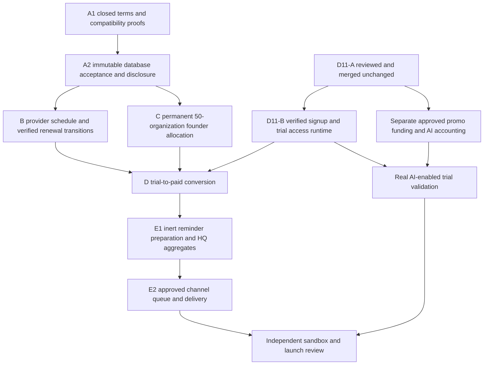

# HON OS launch pricing and trial conversion — source audit and Commercial A1

Source audit: 2026-10-24. Verified main **9c1e0ca6021aff86749a9f56ca212356e1d1b1c0**, tree **5d349176eb72671f167ada712086ec74f282d0bd**. D10 is merged; D11-A PR **#72** remains unmerged at **b5ef7cfa2f1ad2c0d8acb5b76fbfb0f3de0aac02**. That branch/migration is read-only reference, not a dependency of A1. Active PR #73 owns AI presentation; no frontend or agent code is changed here.

The latest owner instruction supersedes older NEW-sale tier/lifetime proposals in CLAUDE.md, docs/hon/OWNER_COMMERCIAL_POLICY.md and strategy PR #57. Historical accepted prices, purchased lifetime rights and legitimate prior commitments are not superseded. Older documents remain historical evidence. Some architecture documents still say “not merged” or describe the pre-D10 policy gap; the code on this exact main is authoritative: 0181–0186 are merged and 0186 enforces exception-only approval. Source merged does not mean deployed or commercially enabled.

## Final launch intent (not a published configuration)

One product **HON OS**, with the former Complete-level capability policy. CORE/COMPLETE trial profiles are internal controls, not public product choices.

| Arrangement | Initial USD minor units | Introductory paid periods | Subsequent USD minor units |
| --- | ---: | ---: | ---: |
| Standard monthly | 24900 | 0 | 24900/month |
| Standard annual | 209700 | 0 | 209700/year |
| Founder monthly | 19920 | 12 monthly periods | 24900/month from paid period 13 |
| Founder annual | 149400 | 1 annual period | 209700/year from paid period 2 |

Annual comparison reference: **24900 × 12 = 298800**. Founder year one is 50% below that reference, not 50% below 209700. Standard annual saves **89100**, approximately **29.82%**; **209700 is authoritative**, never replaced with a computed 30%-discount price (209160). Monthly introduction is 20%. No stacking. First 50 eligible paying organizations share one founder allocation pool; a trial is not a founder allocation. No new lifetime sales. The proposed customer trial is 14 days with no automatic purchase, charge or subscription activation.

These finalized prices and duration are business direction, not an approved trial-policy database record, published offers, paid access or spending authority. HQ still configures future versioned prices/windows within separately approved rules. No price/policy is seeded by A1.

## Capability and gap matrix

| Concern | Existing implementation and source | Gap / action |
| --- | --- | --- |
| One product; HQ offer sets | 0181 `saas_offer_sets`, immutable published `saas_offer_set_offers`, explicit digest publication, history, sales stops; `saas-offers.ts` | Reuse. Current schema has a single price and six kinds, including lifetime. Add a separately versioned schedule; enforce no-new-lifetime on new sales without erasing history. |
| Accepted checkout terms | 0182 `saas_hon_os_accepted_offer`, `saas_open_hon_os_checkout`, subscription `accepted_offer`/digest | Reuse identity/snapshot lineage. No initial/future-price pair, period-count rule, promotion history or customer schedule acknowledgement exists. Do not encode the new promise in free text or FIXED_MONTHS. |
| Provider agreement | `payments/payment-provider.ts` HostedCheckoutRequest; `stripe-test-mode-adapter.ts:createCheckoutSession` | One recurring unit amount only; no provider schedule/phase verification. Annual AUTO_RENEW_AT_CURRENT_PRICE is refused. A new fixed, accepted schedule is not current-price repricing. Provider-backed transition is a separate review gate. |
| Renewal | 0182 `saas_apply_renewal`, `saas_provider_invoice` | Compares against `s.price_minor` and builds invoice lines from that amount. Index is anchored service-period state, not an independent count of distinct paid promotion periods. Need append-only pricing/payment-period evidence and phase-aware invoices. |
| Event verification/idempotency | B5 signatures and normalized events; 0173 initial invoice-paid correction; provider event/payment-reference uniqueness; retryable pending dependencies | Preserve. Extend the normalized closed evidence for verified schedule/phase identity; event arrival order and failed renewals must not consume promotion periods. No redirect proof. |
| Founder pool | 0182 `saas_hon_os_founder_usage`, 0185 `saas_hon_os_refusal`; inventory mutex; checkouts hold inventory until expiry/cancel | Already global across HON OS offer versions, separate from legacy pool. Counts non-VOIDED subscriptions/CREATED or OPEN unexpired checkouts against a per-set configurable limit (up to 1000), not permanent distinct-organization awards capped at 50. Needs durable promotion/eligibility/allocation history and review holds. |
| Stop/old prices | 0182 accepted snapshots + 0183 D6 handling; protected published/retired-offer stop-sales | Reuse accepted-price and approx. 24-hour checkout rights. Review payments after expiry/stop; do not silently replace accepted terms. |
| New-school account | 0183 private `initialize_saas_hon_os_school_account`; SUSPENDED entitlement, AWAITING_FIRST_PAYMENT; provider-evidence first-payment transition | Reuse records/authorities only through a future reviewed signup route. Initializer is not runtime-executable and needs ACTIVE paid-access program; not public signup/trial enrollment. |
| Legacy rights | 0184 closes legacy new-sale paths, preserves renewal/refund/dispute history; existing lifetime subscriptions remain recognizable | Preserve all readers and accepted rights. New HON OS lifetime kinds are still in v1; this A1 does NOT close those existing v1 routes. Launch is blocked until a new-sale gate is implemented and reviewed. |
| Exceptions | 0185 D9 provisioning, grant/revoke/cleanup and 0186 D10 approval ledger | Reuse audit/security discipline only. Never model a customer trial as an exception or relabel PAID_ACCESS approval. |
| Customer trials | #72 / proposed 0187 immutable policies/decisions/campaign metadata; program pinned INACTIVE | Unmerged; no signup, verified email enrollment, entitlement grants, expiry, conversion or notification runtime. A published definition is not a trial. |
| Identity/abuse | Verified HON identity, principal uniqueness, school/organization scopes and forced RLS | No source-grounded customer signup/email-verification authority or complete business-identity/repeat-trial policy. Do not assume an OIDC email string proves email verification or identifies a unique business. |
| Promotional AI | B3 verified cost evidence, priced operations, reserve/finalize/UNKNOWN accounting; paid subscription allowance authority | Reuse patterns; paid allowances are NOT trial funds. Need separately approved funding, promo accounts/ledger, attribution and per-school/campaign/global money caps. No dummy subscriptions or metadata-derived credits. |
| HON/agents | Existing governed coordinator/draft tools/Action Engine and real CRM services | Reuse supported capabilities; not all seven employees have complete runtimes. A trial UI cannot claim a working employee merely from a portrait or granted tier. No unrelated orchestration changes here. |
| Communications | Existing consent/message history and inert outbox foundations, separate staff/family boundaries | No trial-conversion recipient authority, scheduler, templates, channel permission/quiet-hour integration or delivery adapter is provided here. Prepare/queue/delivery are distinct gates. |
| HQ reporting | Authorized offer management/founder counts, invoices/evidence, access status and verified cost reads | Reuse. Need authoritative aggregates for trial cohorts/conversions/promo exposure and scheduled transitions. Bounded recent history is not an aggregate; scheduled revenue is not cash received. |

## What A1 actually implements

- `packages/contracts/src/saas-introductory-pricing.ts`: closed, copied/frozen **internal** schedule terms and explicit acknowledgement-intention validator. Only four recurring payment arrangements; explicit USD minor-unit initial/future amounts; 12 monthly or one annual introductory paid period; no stacking or promotion-reset instruction. A business-reference factory represents the owner's prices without creating/publishing offers.
- `packages/domain/src/saas-introductory-pricing.ts`: side-effect-free hypothetical period-price and savings previews. All previews keep purchasing/payment/access unavailable. An ordinal supplied to this function is NOT an authoritative payment count. No event reducer, official balance, payment transition or entitlement decision exists here.
- Contract/API compatibility tests: v1 offer and checkout validators reject scheduled-price fields and acknowledgement/payment claims rather than silently dropping them. No adapter maps this contract into a flat-price v1 checkout. Existing v1 historical types, cancellation and receipts stay unchanged.
- Existing draft-safe CI runs repository tests/check/build, current 178-file migration validation, all 37 PostgreSQL proofs and 10 guarded commercial rehearsals. No migration or checksum-manifest change is needed or made.

This is executable contract/validation groundwork, **not a completed renewal engine or purchasable launch offer**. No new endpoint, database authority, approval, provider call, UI, customer activity, billing behavior or external delivery is implemented. Existing v1 FIXED_MONTHS plus priceMinor does not enforce a 12-paid-period transition. Naming a flat-price offer “first year” cannot make that safe. Commercial activation remains NO-GO until the following boundaries are reviewed and implemented.

## Revised architecture and dependency graph

All nodes are independent draft review gates; this assignment implements **A1 only**. A2 may be prepared after A1 review; do not bundle B/C/D/E or D11-B here. A2/B/C need not wait for enrollment, but must preserve the D11-A schema boundary and validate combined migration order. No current PR is merged or modified by this work.

### A2: accepted terms and immutable evidence

Use an additive migration with the next available number **after checking all active branches**; 0179/0180 remain reserved and #72 already owns 0187. A1 consumes no number. Add immutable schedule versions associated with NEW offer versions; keep the original accepted_offer/digest and historical subscription price contracts. Explicit new checkout schema must bind exact organization/school, offer/set revision, schedule digest, terms/refund/cancellation references, customer identity/confirmation and trace IDs server-side. The client supplies selectors and explicit acknowledgement, never prices, eligibility, verified payment or access authority. Preview is read-only; confirm rechecks live authority, availability, expected revisions and digest. Customer price acknowledgement is not agreement signature, general consent or payment authorization beyond its actual scope.

Reject purchase while the provider cannot demonstrate the entire accepted schedule. Do not weaken immutable price locks, use AUTO_RENEW_AT_CURRENT_PRICE, mutate historical s.price_minor in place or trust a UI/provider-ready Boolean. A new pricing generation must dispatch through a separate verified path; v1 continues its historical locked-price behavior. Future audit entities include schedule version/acceptance and provider-binding evidence, using canonical request/audit/inert outbox and forced private RLS. No receipt is forged by a type validator.

**Migration integration dependency:** #72's 0187 extends audit/outbox CHECK allowlists with a full literal list. A later migration that adds new events must preserve that list. Applying an independent higher-number migration before an unchanged 0187 could cause 0187 to reject/remove those later event codes. Before A2's database PR, agree the merge/apply order (#72/0187 before the extending migration) OR independently review a compatible additive repair. Do not edit #72 or assume its approval/merge. Prove both fresh-install and supported populated-history sequences; fail closed on unsupported order. Contract-only A1 avoids this dependency entirely.

### B: immutable future price, distinct verified paid periods

Persist schedule commitment and append-only paid-period facts, uniquely bound to organization, subscription, promotion-consumption lineage, canonical service period, verified invoice/payment references and schedule phase. Count **distinct successfully established paid billing periods**; current service period_index alone is insufficient. Calendar time, failed invoices, duplicate deliveries, free periods, arbitrary browser counts and new subscription IDs must not consume or restore an introduction. Refund/dispute effects on promotion consumption need owner policy, not silent subtraction.

| Situation | Required future behavior |
| --- | --- |
| Monthly paid periods 1–12 / 13 onward | 19920 / 24900, both accepted before purchase |
| Founder annual paid period 1 / 2 onward | 149400 / 209700, not half of standard annual |
| Standard annual | Exactly accepted 209700; no 30% recomputation |
| Failed renewal | No paid-period increment, no invented receipt; keep recoverable payment/access state |
| Duplicate or delayed/out-of-order webhook | Reuse unique canonical payment/period facts; retry pending dependencies, no double invoice/evidence or premature phase advance |
| Different amount/currency/period/schedule | Review without treating it as successful renewal; no access upgrade from an unverified event |
| Cancellation/resubscription | Keep organization promotion-consumption evidence; no reset from new key/account/subscription |
| HQ edits prices | New offers only; the customer's scheduled future amount remains accepted, not “whatever HQ charges then” |

Provider schedule creation/update requires its own idempotency and UNKNOWN reconciliation; no provider call inside a DB transaction. Verify provider schedule/price/interval/phase evidence against the committed HON schedule before purchase becomes available. Stripe's calendar iterations alone cannot prove 12 *paid* periods: failures/retries/pause behavior must be independently established against the pinned provider API. If no safe provider mechanism matches this policy, keep the affected offer unavailable and return for a policy/provider decision. Do not promise that an invoice notification guarantees the next provider charge is correct. Real Stripe sandbox parity is required after simulated proofs and before any live enablement.

Use the existing canonical lock graph (IAM/live authority → request claim → inventory → checkout → organization/entitlement and narrowly ordered subscription/evidence resources). Add schedule/payment-period locks only after auditing every competing path. Recheck authority and digest after waits; rollback business/evidence/claim/audit/outbox together. Preserve accepted refund windows, account credits, legitimate Champions/historical rights and payment evidence distinctions. Discount stacking does not authorize deleting earned credits.

### C: permanent founder allocation and trial availability

**Recommendation requiring owner approval: availability-only during a trial**, with a bounded hold created atomically at purchase confirmation. This reuses the existing approximately 24-hour checkout hold, avoids tying up scarce slots for 14 days and reduces signup farming. Do not promise a guaranteed founder price when the trial starts. If the pool fills first, show the actual eligible standard offer and require a new explicit price review; never silently substitute the charge.

A trial reservation is an alternative owner decision, not implemented/defaulted here. It needs a verified-identity/business rule, short approved expiry, capacity accounting, one reservation per eligible organization and recovery policy; it must count against the same global cap.

Replace mutable non-VOIDED-subscription counting as the sole allocation authority with immutable organization allocation/consumption history and explicit hold/review lifecycle. Enforce **50 final allocations maximum globally**, independent of per-offer or accepted-set limits. Trial start never allocates. An expired unpaid hold releases; a verified paid-but-review case preserves evidence and should quarantine its capacity pending explicit resolution (owner decision). A cancellation/refund/VOIDED record must not silently make a consumed founder promotion reusable. HQ reads allocated/held/review/remaining from complete authoritative records, not a truncated list. Legacy founder inventory remains separate. Verify first/49th/50th/51st and concurrent boundary purchases, cross-version holds, payment-after-expiry and review resolution. Before deployment, inspect existing founder commitments/accepted checkouts through a separately authorized persistent-data audit; A1 accesses none.

### D11 runtime and trial-to-paid integration

Dependency on #72 is precisely: independently reviewed/merged policy version+decision identifiers, campaign version+publication identifiers, exact approved policy window/limits, live-owner authority and the INACTIVE trial program boundary. A publication or D9/D10 approval is never an enrollment grant. Configure 14 days through a later explicit approved trial policy/campaign, not a migration seed. No imported #72 code, dependency or policy record exists in A1.

Future D11-B must provide verified-email identity enrollment, explicit versioned trial terms, duplicate-business/repeated-trial review, canonical organization/school/user links, immutable enrollment/provenance, server-controlled start/end and trial-specific entitlement authority. Preserve same organization, school data, permitted staff and saved AI work during conversion; no data migration to another “paid school.” Default paid-only benefits/Champions eligibility to denied for trial provenance until separately decided. Do not infer eligibility from COMPLETE plus ACTIVE alone.

| Conversion case | Required contract; no runtime implemented here |
| --- | --- |
| Early purchase before day 14 | Explicitly disclose when paid billing/service starts. Immediate start vs honoring remaining trial is an owner decision; no implicit proration, extra discount or undisclosed delayed charge. |
| Purchase after trial ends | Preserve identity/data; allow only separately authorized billing/recovery reads. Restore permitted capabilities only from verified paid authority. |
| Checkout still pending at trial expiry | Trial stops by checked effective_until even without cleanup. Pending checkout is not paid access or extra trial time. A still-valid verified payment may subsequently activate paid access. |
| Failed/cancelled/expired checkout | No false activation. Preserve exact retry/reconciliation evidence and supported recovery. Payment after checkout expiry remains review, not a browser-success grant. |
| Cleanup races with paid activation | Serialize on the canonical organization/access source. Cleanup must match TRIAL source id + expected source/entitlement version; never revoke a PAYMENT_ACTIVE replacement or newer access source. Test both lock orders. |
| Campaign withdrawal | Refuse new enrollment under a withdrawn publication. Effect on already accepted trials requires explicit policy (honor remaining term vs authorized abuse revocation), never deletion or inferred exception access. |

Every capability boundary checks server time/provenance/window; a scheduler is housekeeping, not expiry authority. Registration/email verification alone grants no paid subscription. Paid activation remains independently gated on real verified evidence and approved paid-access policy/program.

### AI trial quality and separate spending authority

Reuse real governed HON/agent/CRM tools where built, saved drafts/approvals and truthful work statuses across presentation modes. Maintain the seven-agent product vision; do not claim incomplete agents execute tasks or replace them with generic demo replies. AI/UI owners retain their files.

Add separately reviewed promotional funding and append-only reserve/finalize/release/expire/UNKNOWN accounting, attribution to school/campaign/funding approval and verified provider cost evidence. Enforce credit and actual money ceilings per request/school/campaign/global, model/capability allowlists, expiry and rate/concurrency limits before execution. Reserve before provider calls; uncertain results retain a hold until reconciled. Keep provider calls out of DB locks. Audit a compatible new lock graph before implementation. No paid allowance or fake subscription may fund a trial, and offer/campaign budget metadata is not money or credits. Preserve trial vs paid cost attribution on conversion without double grants or bypassing caps.

### E: notifications and authoritative HQ reporting

Proposed configurable milestones: day 7 value/usage, day 11 eligible offer, day 13 ending, day 14 expiry/conversion. These are not active scheduled jobs. Use enrollment's verified time anchor, recipient language/timezone and quiet-hour policy. Never insert fictional activity: summaries use authorized durable work/cost facts with as-of times; unavailable metrics remain unavailable. Quote actual school eligibility/accepted offer and expiry; revalidate at preparation/queue/delivery and suppress stale founder promises or already-converted reminders.

Proposed lifecycle: PREPARED → separately authorized QUEUED → delivery attempt → DELIVERED / FAILED / UNKNOWN. “Prepared” is not queued or delivered. Record verified recipients/preferences/consent/channel authority and content/price/terms digest; use a stable deduplication identity across retries (enrollment, milestone, recipient, channel) with explicit content revisions. UNKNOWN delivery is reconciled, not blindly resent. A policy/campaign/consent withdrawal suppresses unauthorized future sends. No email/SMS/push provider or external delivery is activated by these contracts.

HQ aggregates must be complete, independently authorized database reads: trial cohorts/current windows, paid conversions, immutable founder allocations/holds/reviews, recorded vs verified payments/refunds/disputes, upcoming accepted schedule transitions, and reserved/settled/unknown promotional costs. Keep proposed exposure, scheduled renewals, payment evidence, net cash and actual provider costs separate. Do not sum a bounded history window or count published metadata as customers/revenue. Reuse the approved HQ design later; no frontend reporting implementation here.

## Ordered PR boundaries and acceptance tests

| PR | Scope and dependencies | Required evidence |
| --- | --- | --- |
| **A1 — this draft** | Closed internal schedule/acknowledgement contracts, exact-money hypothetical previews, old-path refusal tests and this audit/graph. Main only; no migration or operational endpoint. | 12→13 and year 1→2 arithmetic, explicit reference savings, USD/closed-schema/immutability/no-stacking/no-lifetime, no price claims reaching DB/provider; full current regressions. |
| A2 — acceptance storage | After A1 review and migration-order agreement with #72; new immutable offer/acceptance/evidence schema and explicit disclosure confirmation. No provider enablement. | Live HQ/school authorization, tenant/role revocation, preview/revision/key conflicts, immutable historical terms, no direct-table bypass, all-or-nothing audit/outbox. |
| B — provider/renewal | After A2 review; isolated new pricing generation dispatch and provider schedule binding. | Distinct verified paid periods; monthly 12→13, annual 1→2, failed/recovered/duplicate/out-of-order events, UNKNOWN provider results, amount/phase mismatch, no undisclosed charges or legacy repricing; simulator first, real sandbox separate approval. |
| C — founder allocation | After A2 review; permanent distinct-organization promotion history, global cap and bounded holds. | 1/49/50/51; concurrent last slot; cross-set limits; repeated accounts/trials/cancellation; expiry/review holds; legacy pool unchanged. |
| D11-B / promo funding | After independently merged #72 and explicit owner policies; separate enrollment and promo-accounting PRs. | Duplicate verified identities/ambiguous business review, exact-school isolation, effective expiry without cleanup, no paid-only benefits/normal credit leakage, real authorized tools with no unapproved provider spend. |
| D — conversion | After B/C and reviewed D11 enrollment authority; same-school provenance-safe transition. | Early/expired/pending/failed conversion, campaign withdrawal, expiry vs verified payment both lock orders, paid cleanup protection, explicit purchased amount and separate activation result. |
| E1 / E2 — reminders/reporting then delivery | E1 inert preparation/read-only aggregates after D contracts; E2 separately approved provider/consent integration. | True metrics/prices, stale/converted suppression, quiet hours/consent/revocation, deduplication, prepared/queued/delivered/failed/unknown distinctions, no unauthorized delivery. |

All database PRs extend disposable PostgreSQL proofs/security registries and guarded rehearsals with exact migration hashes, restored shipped posture, no real-school effects and provider/AI write tripwires. A1 does not claim unimplemented future tests passed. End-to-end launch additionally requires sandbox/provider schedule parity, approved policies, persistent-history/migration rehearsal, monitoring/backups/rollback and explicit deployment/payment/spending authorization.

## Owner decisions still needed (not a request to reconfirm finalized prices)

| Decision | Recommendation / boundary pending owner approval |
| --- | --- |
| Trial founder availability vs reservation | Recommend availability-only until atomic checkout hold; no promise during trial. |
| Eligible new business / multi-school ownership / repeat trials | Canonical organization/business evidence, duplicate-identity review and anti-farming rules; do not auto-merge identities or use email alone. |
| Paid promotion-period semantics after refund/dispute/free credits | Define qualifying payment coverage and refund consequences; failed invoices/free periods do not automatically count, cancellation never resets history. |
| Founder cancellation/refund/review allocation disposition | Recommend durable consumed rights and quarantined paid-review capacity; no automatic slot return or reusable introduction. |
| Early conversion billing start | Immediate verified purchase vs remaining-trial honor; disclose exact dates, no assumed proration. |
| Valid old unpaid lifetime checkout at launch cutover | Preserve purchased lifetime rights; explicitly decide accepted but unpaid checkout treatment and any stop/review policy. |
| Post-introduction future price changes | Current accepted schedule fixed at 24900 / 209700; any further increases require a separate consent/notice/contract-rights policy. |
| Refund/cancellation/tax and existing earned credits | Preserve accepted rights; decide new-policy references, stacking vs legitimate credit settlement and provider treatment before sale. |
| Trial policy approval and withdrawal | Allowed [14] duration, policy validity, capabilities, eligibility, capacity, campaign windows and existing-trial withdrawal effects need explicit D11 approval; no seed. |
| AI funding and capabilities | Actual promo amount/expiry, request/school/campaign/global money caps, models/tools, verified costs, UNKNOWN holds, abuse thresholds and budget approver. |
| Communications and data retention | Approved channels/verified recipients/consent/quiet hours, template schedules, retention/export after expiry and approved external providers. |
| Operational enablement | #72 review/merge separate; B6/paid access, real Stripe sandbox, provider spending, rollout/migration rehearsal and deployment are independent gates. |

Finalized amounts, 50-organization direction, single HON OS product and no-new-lifetime direction are preserved as supplied; this matrix concerns remaining operational semantics. Stop after the A1 draft and its verification. No dependent implementation, merge, deployment, actual policy approval, trial activation, payment, external message or AI-credit grant is authorized here.
