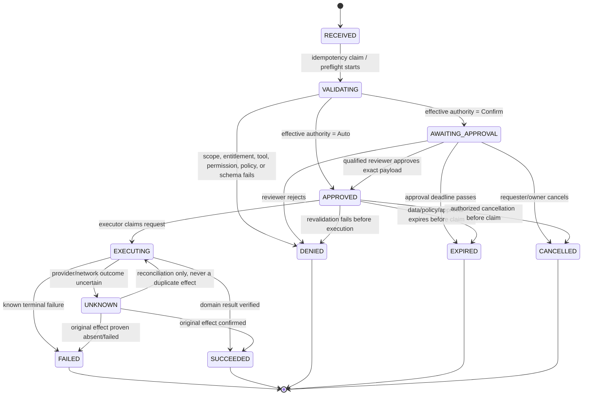

# HON RLS, Tenant-Scoped Pooling, and Action Engine Implementation Supplement

**Status:** Detailed technical design — no application code has been started
**Companion:** `HON_CORE_PLATFORM_ARCHITECTURE.md`
**Scope:** How HON applies PostgreSQL Row-Level Security safely with connection pooling, and how the Action Engine turns an AI tool call into a secure, auditable, idempotent domain operation.

---

## 1. Executive implementation position

HON uses a **shared PostgreSQL database and shared tables**, not a database/schema per school. Tenant isolation is enforced in four mutually reinforcing places:

```text
Verified request identity
  → server authorization decision
  → transaction-bound tenant context
  → PostgreSQL RLS + explicit scoped queries
  → domain-service permission / policy checks
  → audit and outbox evidence
```

The key connection-pooling rule is simple:

> **A database connection is never a tenant connection. A transaction is a tenant-scoped execution unit.**

A pooled connection may serve School A on one request and School B on the next request. Therefore, every database operation—reads included—runs inside an explicit transaction that binds a verified `principal + organization + selected school scope` using `SET LOCAL` behavior. At commit or rollback, that binding disappears before the connection can return to the pool.

For AI work, a model is never permitted to call a domain service directly. The gateway path is:

```text
LLM structured tool call
  → registered Tool Gateway
  → Action Engine preflight and policy resolution
  → Auto / Confirm / Restricted decision
  → approval when required
  → durable idempotent executor
  → normal domain service
  → verification, audit, outbox, and work-state update
```

---

# Part I — PostgreSQL Row-Level Security and connection pooling

## 2. Threat model and what RLS does—and does not—solve

### 2.1 Threats this design prevents

| Threat | Protection |
|---|---|
| A staff member guesses another school's record UUID | API authorization, explicit tenant filters, RLS scope policy, and composite foreign keys deny access. |
| A repository omits a school filter by mistake | RLS returns only rows permitted by the transaction context. |
| An insert pairs Organization A with School B | Composite foreign key `(organization_id, school_id) → tenancy.schools` rejects it. |
| A pooled database connection leaks a previous tenant context | Explicit transaction plus `SET LOCAL`; rollback/commit clears the context. |
| A school-scoped instructor queries Billing or another location | Table operation policy checks both school scope and the specific permission code. |
| Parent/Eian attempts to read all school students | Parent-specific policies require an active family relationship; staff permission policies do not apply. |
| Worker retries a previously processed tenant event | The worker binds the original event tenant context and uses consumer/action idempotency records. |

### 2.2 Explicit limitation

PostgreSQL custom configuration settings (for example `hon.principal_id`) are not cryptographic credentials. A role capable of issuing arbitrary SQL can also issue `set_config()`.

Therefore:

- **RLS protects against accidental unscoped application queries and ordinary application defects.**
- It does **not** make arbitrary SQL injection harmless if an attacker gains the trusted backend database role and can impersonate identity context.
- HON must still use parameterized SQL/ORM parameters, prohibit dynamic SQL from user/model input, keep database credentials server-only, validate all inputs, and restrict `EXECUTE`/table grants.

For an initial NestJS service with no client database access, the trusted-backend context model below is the appropriate practical baseline. If HON later exposes database-facing APIs through an untrusted client gateway, it must use a gateway-verified, cryptographically signed claim/capability design described in §12 instead of treating caller-controlled settings as identity.

---

## 3. Roles, grants, and default-deny posture

### 3.1 Runtime roles

| PostgreSQL role | Runtime use | Permitted capability |
|---|---|---|
| `hon_owner` | Non-login object owner | Own tables/functions; no runtime credentials. |
| `hon_security_owner` | Non-login security-function owner | Own only narrow `SECURITY DEFINER` authorization/context helper functions. |
| `hon_api` | NestJS HTTP/API process | Call approved context functions and access explicitly granted tenant tables under RLS. No `BYPASSRLS`. |
| `hon_worker` | Durable work/outbox/automation workers | Same RLS posture as API, using machine principals; may execute carefully scoped queue functions. |
| `hon_outbox_dispatcher` | Outbox transport publisher | Executes only a narrow `SECURITY DEFINER` claim/mark function; cannot browse business tables. |
| `hon_migrator` | CI/CD migration process | Runs migrations only; not used by HTTP/worker runtime. |

### 3.2 Required role restrictions

```sql
-- Representative security posture; credentials and membership are deployment-managed.
ALTER ROLE hon_api              NOSUPERUSER NOCREATEDB NOCREATEROLE NOREPLICATION NOBYPASSRLS;
ALTER ROLE hon_worker           NOSUPERUSER NOCREATEDB NOCREATEROLE NOREPLICATION NOBYPASSRLS;
ALTER ROLE hon_outbox_dispatcher NOSUPERUSER NOCREATEDB NOCREATEROLE NOREPLICATION NOBYPASSRLS;
ALTER ROLE hon_owner            NOLOGIN;
ALTER ROLE hon_security_owner   NOLOGIN;

REVOKE ALL ON SCHEMA public FROM PUBLIC;
REVOKE ALL ON DATABASE hon FROM PUBLIC;
REVOKE ALL ON ALL TABLES IN SCHEMA tenancy, iam, people, students, crm,
  billing, audit, eventing, action_engine, ai FROM PUBLIC;
REVOKE ALL ON ALL FUNCTIONS IN SCHEMA security FROM PUBLIC;
```

**Rules**

1. No mobile/web browser, AI provider, provider webhook, or third-party integration gets a PostgreSQL credential.
2. `hon_api`, `hon_worker`, and `hon_outbox_dispatcher` never own application tables and never receive `BYPASSRLS`.
3. `SECURITY DEFINER` functions are exceptional. They must be small, use fixed SQL only, set a safe `search_path`, validate all inputs, and be narrowly granted. They must never accept arbitrary table/column names, arbitrary filters, SQL fragments, or generic JSON-to-SQL instructions.
4. IAM authorization metadata is readable by normal code only through approved functions/query services. This minimizes direct exposure of all role mappings.
5. A production health check must assert `rolbypassrls = false` for every runtime application role.

---

## 4. Tenant ownership data rule

Every school-owned operational table has these minimum columns:

```sql
id                          uuid PRIMARY KEY DEFAULT gen_random_uuid(),
organization_id             uuid NOT NULL,
school_id                   uuid NOT NULL,
created_at                  timestamptz NOT NULL DEFAULT now(),
created_by_principal_id     uuid,
updated_at                  timestamptz NOT NULL DEFAULT now(),
updated_by_principal_id     uuid,
version                     integer NOT NULL DEFAULT 1
```

And each table has this composite foreign key:

```sql
FOREIGN KEY (organization_id, school_id)
  REFERENCES tenancy.schools (organization_id, id)
  ON DELETE RESTRICT
```

Every relation from one school-owned record to another uses **both** tenant keys plus entity ID where practical:

```sql
FOREIGN KEY (organization_id, school_id, lead_id)
  REFERENCES crm.leads (organization_id, school_id, id)
```

This makes an invalid mixed-tenant relation impossible even if a future service has a bug.

### 4.1 Query rule

Even though RLS is active, all repository queries must visibly include the scope:

```sql
SELECT id, status, next_follow_up_at
FROM crm.leads
WHERE organization_id = $1
  AND school_id = $2
  AND id = $3;
```

RLS is a final guardrail. Explicit predicates are still required for correctness, index use, code review clarity, and avoiding accidental organization-wide operations.

---

## 5. Tenant context function design

### 5.1 Context contents

A bound transaction context includes:

| Setting | Meaning | Set by |
|---|---|---|
| `hon.principal_id` | Initiating human/machine principal | verified backend context binder |
| `hon.principal_type` | Human, AI employee, automation, integration, or system | context binder |
| `hon.organization_id` | Organization selected for this transaction | context binder |
| `hon.school_ids` | Array of selected schools allowed for this query/command | context binder |
| `hon.request_id` | End-user/API request trace ID | gateway |
| `hon.correlation_id` | Cross-service/business-flow trace ID | gateway/work engine |
| `hon.causation_id` | Event/action that caused current work | worker/action engine |
| `hon.source` | UI, API, AI, automation, integration, migration, support | context binder |

The context is **not** an input DTO. It is created by the authenticated request pipeline after it resolves identity and permissions. Controllers never trust an `organizationId`, `schoolId`, `principalId`, or `source` contained in a JSON body.

### 5.2 Supported scopes

HON uses three deliberate request patterns:

| Pattern | Context school set | Typical use |
|---|---|---|
| **Single-school command** | exactly one school ID | CRM mutation, billing action, attendance, class booking, Parent App request |
| **Explicit multi-school read** | verified subset of accessible schools | owner KPI comparison, cross-location task list |
| **Organization control operation** | no school table access unless the operation specifically expands a verified set | role configuration, organization defaults, school provisioning |

All CRM and Billing writes are **single-school commands**. A cross-school transfer is a named domain operation that binds both explicitly authorized schools and creates transfer history; it is never a generic `UPDATE school_id` query.

### 5.3 Request-context helper functions

The following functions intentionally fail closed if context is absent or malformed:

```sql
CREATE OR REPLACE FUNCTION security.current_principal_id()
RETURNS uuid
LANGUAGE sql
STABLE
AS $$
  SELECT NULLIF(current_setting('hon.principal_id', true), '')::uuid
$$;

CREATE OR REPLACE FUNCTION security.current_organization_id()
RETURNS uuid
LANGUAGE sql
STABLE
AS $$
  SELECT NULLIF(current_setting('hon.organization_id', true), '')::uuid
$$;

CREATE OR REPLACE FUNCTION security.current_school_ids()
RETURNS uuid[]
LANGUAGE sql
STABLE
AS $$
  SELECT COALESCE(
    NULLIF(current_setting('hon.school_ids', true), '')::uuid[],
    ARRAY[]::uuid[]
  )
$$;

CREATE OR REPLACE FUNCTION security.scope_is_selected(
  p_organization_id uuid,
  p_school_id uuid
) RETURNS boolean
LANGUAGE sql
STABLE
AS $$
  SELECT p_organization_id = security.current_organization_id()
     AND p_school_id = ANY(security.current_school_ids())
$$;
```

No context yields a `NULL` principal, `NULL` organization, and empty school array. Since every policy checks `scope_is_selected(...)`, an unbound transaction sees no tenant rows and cannot insert a row.

### 5.4 Verified binding function

This is representative SQL; migrations should add test fixtures and use the actual roles/table names adopted by the codebase.

```sql
CREATE OR REPLACE FUNCTION security.bind_request_context(
  p_principal_id uuid,
  p_organization_id uuid,
  p_requested_school_ids uuid[],
  p_principal_type iam.principal_type,
  p_request_id uuid,
  p_correlation_id uuid,
  p_causation_id uuid DEFAULT NULL,
  p_source text DEFAULT 'HUMAN_UI'
) RETURNS void
LANGUAGE plpgsql
SECURITY DEFINER
SET search_path = pg_catalog, tenancy, iam, security, pg_temp
AS $$
DECLARE
  v_allowed_school_ids uuid[];
BEGIN
  IF p_principal_id IS NULL
     OR p_organization_id IS NULL
     OR COALESCE(cardinality(p_requested_school_ids), 0) = 0 THEN
    RAISE EXCEPTION 'Tenant context is incomplete'
      USING ERRCODE = '42501';
  END IF;

  IF NOT EXISTS (
    SELECT 1
    FROM iam.principals p
    JOIN iam.organization_memberships om
      ON om.principal_id = p.id
    WHERE p.id = p_principal_id
      AND p.principal_type = p_principal_type
      AND p.status = 'ACTIVE'
      AND om.organization_id = p_organization_id
      AND om.status = 'ACTIVE'
  ) THEN
    RAISE EXCEPTION 'Principal is not an active organization member'
      USING ERRCODE = '42501';
  END IF;

  SELECT COALESCE(array_agg(DISTINCT s.id), ARRAY[]::uuid[])
    INTO v_allowed_school_ids
  FROM tenancy.schools s
  WHERE s.organization_id = p_organization_id
    AND s.status IN ('ONBOARDING', 'ACTIVE')
    AND EXISTS (
      SELECT 1
      FROM iam.role_assignments ra
      WHERE ra.organization_id = p_organization_id
        AND ra.principal_id = p_principal_id
        AND ra.revoked_at IS NULL
        AND ra.starts_at <= now()
        AND (ra.ends_at IS NULL OR ra.ends_at > now())
        AND (ra.scope = 'ORGANIZATION' OR ra.school_id = s.id)
    );

  IF EXISTS (
    SELECT 1
    FROM unnest(p_requested_school_ids) AS requested_school_id
    WHERE NOT requested_school_id = ANY(v_allowed_school_ids)
  ) THEN
    RAISE EXCEPTION 'Requested school is outside active principal scope'
      USING ERRCODE = '42501';
  END IF;

  -- true = transaction-local. These disappear on COMMIT or ROLLBACK.
  PERFORM set_config('hon.principal_id', p_principal_id::text, true);
  PERFORM set_config('hon.principal_type', p_principal_type::text, true);
  PERFORM set_config('hon.organization_id', p_organization_id::text, true);
  PERFORM set_config('hon.school_ids', p_requested_school_ids::text, true);
  PERFORM set_config('hon.request_id', p_request_id::text, true);
  PERFORM set_config('hon.correlation_id', p_correlation_id::text, true);
  PERFORM set_config('hon.causation_id', COALESCE(p_causation_id::text, ''), true);
  PERFORM set_config('hon.source', p_source, true);
END;
$$;

REVOKE ALL ON FUNCTION security.bind_request_context(
  uuid, uuid, uuid[], iam.principal_type, uuid, uuid, uuid, text
) FROM PUBLIC;
GRANT EXECUTE ON FUNCTION security.bind_request_context(
  uuid, uuid, uuid[], iam.principal_type, uuid, uuid, uuid, text
) TO hon_api, hon_worker;
```

### 5.5 Important binding rules

1. The API derives `p_principal_id` from a verified access token/session, never from route/body input.
2. The requested school set normally comes from the route. The binder validates it against live membership and active role assignments before storing it.
3. The binder does not grant a permission merely because a principal has *some* role at a school. Individual table policies and domain services check the specific permission code.
4. Permission lookup cannot be flattened into a simple union of permissions for a multi-school context. A principal might have `billing.invoice.read` at School A and only `crm.lead.read` at School B. Per-row/per-school permission evaluation preserves that distinction.
5. Parent App/Eian uses a different binder path that validates `family_principal_access` and binds the relevant school/family-safe principal; it does not receive a staff-role context.
6. An API worker binds its registered automation/AI/integration principal—not the system worker identity—as the business actor. The original human delegator is retained separately in context/audit where appropriate.

---

## 6. Permission function and RLS policy construction

### 6.1 Permission evaluator

```sql
CREATE OR REPLACE FUNCTION security.has_permission(
  p_principal_id uuid,
  p_organization_id uuid,
  p_school_id uuid,
  p_permission_code text
) RETURNS boolean
LANGUAGE sql
STABLE
SECURITY DEFINER
SET search_path = pg_catalog, iam, security, pg_temp
AS $$
  SELECT EXISTS (
    SELECT 1
    FROM iam.organization_memberships om
    JOIN iam.role_assignments ra
      ON ra.organization_id = om.organization_id
     AND ra.principal_id = om.principal_id
     AND ra.revoked_at IS NULL
     AND ra.starts_at <= now()
     AND (ra.ends_at IS NULL OR ra.ends_at > now())
     AND (ra.scope = 'ORGANIZATION' OR ra.school_id = p_school_id)
    JOIN iam.role_permissions rp
      ON rp.role_id = ra.role_id
    WHERE om.organization_id = p_organization_id
      AND om.principal_id = p_principal_id
      AND om.status = 'ACTIVE'
      AND rp.permission_code = p_permission_code
  )
$$;

REVOKE ALL ON FUNCTION security.has_permission(uuid, uuid, uuid, text) FROM PUBLIC;
GRANT EXECUTE ON FUNCTION security.has_permission(uuid, uuid, uuid, text) TO hon_api, hon_worker;
```

The function should be owned by a no-login security owner that has only the exact metadata read privileges it needs. The fixed `search_path` prevents attacker-controlled object shadowing.

### 6.2 RLS pattern for a mutable table

A table policy must be **operation-specific**. A generic `FOR ALL` policy normally hides which permission protects which action and makes reviews harder.

```sql
ALTER TABLE crm.leads ENABLE ROW LEVEL SECURITY;
ALTER TABLE crm.leads FORCE ROW LEVEL SECURITY;

CREATE POLICY crm_leads_read
ON crm.leads
FOR SELECT
USING (
  security.scope_is_selected(organization_id, school_id)
  AND security.has_permission(
    security.current_principal_id(),
    organization_id,
    school_id,
    'crm.lead.read'
  )
);

CREATE POLICY crm_leads_create
ON crm.leads
FOR INSERT
WITH CHECK (
  security.scope_is_selected(organization_id, school_id)
  AND security.has_permission(
    security.current_principal_id(),
    organization_id,
    school_id,
    'crm.lead.create'
  )
);

CREATE POLICY crm_leads_update
ON crm.leads
FOR UPDATE
USING (
  security.scope_is_selected(organization_id, school_id)
  AND security.has_permission(
    security.current_principal_id(),
    organization_id,
    school_id,
    'crm.lead.update'
  )
)
WITH CHECK (
  security.scope_is_selected(organization_id, school_id)
  AND security.has_permission(
    security.current_principal_id(),
    organization_id,
    school_id,
    'crm.lead.update'
  )
);

CREATE POLICY crm_leads_no_delete
ON crm.leads
FOR DELETE
USING (false);
```

The `WITH CHECK` clause matters. Without it, a principal who is allowed to update a row could potentially alter its `organization_id`/`school_id` into a scope they should not control, subject only to foreign keys.

### 6.3 RLS pattern for immutable financial facts

```sql
ALTER TABLE billing.account_ledger_entries ENABLE ROW LEVEL SECURITY;
ALTER TABLE billing.account_ledger_entries FORCE ROW LEVEL SECURITY;

CREATE POLICY billing_ledger_read
ON billing.account_ledger_entries
FOR SELECT
USING (
  security.scope_is_selected(organization_id, school_id)
  AND security.has_permission(
    security.current_principal_id(),
    organization_id,
    school_id,
    'billing.ledger.read'
  )
);

CREATE POLICY billing_ledger_append
ON billing.account_ledger_entries
FOR INSERT
WITH CHECK (
  security.scope_is_selected(organization_id, school_id)
  AND security.has_permission(
    security.current_principal_id(),
    organization_id,
    school_id,
    'billing.ledger.append'
  )
);

-- Intentionally do not create UPDATE or DELETE policies.
```

Grant only `SELECT, INSERT` to relevant runtime role(s). The `billing.ledger.append` permission should be assigned only to a restricted system/domain-service principal, not to normal staff or AI employees. Staff get invoice/billing read permissions; they do not obtain arbitrary append access to accounting facts.

### 6.4 Parent/family policy pattern

A family-facing row policy never accepts an ID supplied by the client as proof of family membership. It derives access from the bound principal:

```sql
CREATE OR REPLACE FUNCTION security.has_family_access(
  p_principal_id uuid,
  p_organization_id uuid,
  p_school_id uuid,
  p_family_id uuid
) RETURNS boolean
LANGUAGE sql
STABLE
SECURITY DEFINER
SET search_path = pg_catalog, people, security, pg_temp
AS $$
  SELECT EXISTS (
    SELECT 1
    FROM people.family_principal_access fpa
    WHERE fpa.principal_id = p_principal_id
      AND fpa.organization_id = p_organization_id
      AND fpa.school_id = p_school_id
      AND fpa.family_id = p_family_id
      AND fpa.status = 'ACTIVE'
      AND fpa.revoked_at IS NULL
  )
$$;
```

A student progress or parent-safe billing-view policy joins from row → student/family → `has_family_access`. It does **not** reuse a staff `billing.invoice.read` policy or expose school-wide data to Eian.

### 6.5 RLS performance rules

1. All tenant tables need indexes beginning with `(organization_id, school_id, ...)` matching common access patterns.
2. The context functions are `STABLE`, allowing PostgreSQL to treat their values as transaction-stable.
3. `has_permission` uses indexed assignment/permission tables. It must be benchmarked with realistic organization roles and school counts.
4. RLS does not eliminate explicit query predicates; PostgreSQL can use the visible predicates for better planning.
5. Do not cache permission unions in a multi-school GUC unless the cache is keyed by *both school and permission*. A flat union can cause cross-school privilege escalation.
6. The initial target is correctness first. If policy joins become measurable overhead, introduce a transaction-bound verified permission map keyed `{schoolId: permissionCodes}` or a safe per-request temporary cache—but retain the same semantics and tests.

---

## 7. Connection pooling: correct transaction lifecycle

### 7.1 Required pool mode

HON may use direct PostgreSQL pooling in development and PgBouncer **transaction pooling** in production. The application must be correct under transaction pooling from day one.

Why transaction pooling:

- It efficiently shares a finite database connection pool among many web/API requests.
- A connection is held only for the short explicit transaction.
- It forces the application to avoid accidental reliance on per-session tenant state.

### 7.2 The only permitted request sequence

```text
Acquire client from pool
  → BEGIN [READ ONLY for query-only request]
  → SELECT security.bind_request_context(...)
  → perform all scoped repository/domain queries on the SAME client
  → COMMIT on success OR ROLLBACK on any error
  → release client
```

The function calls `set_config(..., true)`, which is transaction-local. Therefore:

```text
Transaction 1 on physical connection #42: School A context → COMMIT
Transaction 2 on physical connection #42: no prior context exists → bind School B
```

No context can survive from Transaction 1 to Transaction 2.

### 7.3 NestJS / Node `pg` transaction wrapper

The following is implementation pseudocode, not a substitute for the domain/service layer:

```ts
type TenantRequestContext = {
  principalId: string;
  principalType: 'HUMAN_USER' | 'AI_EMPLOYEE' | 'AUTOMATION' | 'INTEGRATION' | 'SYSTEM_SERVICE';
  organizationId: string;
  schoolIds: string[];
  requestId: string;
  correlationId: string;
  causationId?: string;
  source: 'HUMAN_UI' | 'PUBLIC_API' | 'AI' | 'AUTOMATION' | 'INTEGRATION' | 'MIGRATION' | 'HQ_SUPPORT';
};

async function withinTenantTransaction<T>(
  context: TenantRequestContext,
  options: { readOnly?: boolean; isolation?: 'READ COMMITTED' | 'REPEATABLE READ' | 'SERIALIZABLE' },
  work: (client: PoolClient) => Promise<T>,
): Promise<T> {
  const client = await pool.connect();
  let transactionStarted = false;

  try {
    const mode = options.readOnly ? 'READ ONLY' : 'READ WRITE';
    const isolation = options.isolation ?? 'READ COMMITTED';
    await client.query(`BEGIN ISOLATION LEVEL ${isolation} ${mode}`);
    transactionStarted = true;

    await client.query(
      `SELECT security.bind_request_context(
         $1::uuid, $2::uuid, $3::uuid[], $4::iam.principal_type,
         $5::uuid, $6::uuid, $7::uuid, $8::text
       )`,
      [
        context.principalId,
        context.organizationId,
        context.schoolIds,
        context.principalType,
        context.requestId,
        context.correlationId,
        context.causationId ?? null,
        context.source,
      ],
    );

    const result = await work(client);
    await client.query('COMMIT');
    transactionStarted = false;
    return result;
  } catch (error) {
    if (transactionStarted) {
      try {
        await client.query('ROLLBACK');
      } catch (rollbackError) {
        // Log the rollback failure through safe infrastructure logging;
        // the connection must not be reused if it cannot be reset.
        client.release(rollbackError as Error);
        throw error;
      }
    }
    throw error;
  } finally {
    // SET LOCAL context is already gone after COMMIT/ROLLBACK.
    // Do not call release until the transaction has definitively ended.
    client.release();
  }
}
```

### 7.4 Wrapper invariants

| Invariant | Reason |
|---|---|
| Every read and write uses `withinTenantTransaction` | A read outside a transaction cannot safely rely on `SET LOCAL` tenant context. |
| The binder is the first business-related statement after `BEGIN` | No query can run in an unbound context. |
| One `PoolClient` stays pinned for the full callback | PgBouncer may switch physical server connections between transactions, never during one transaction. |
| A controller/repository never independently acquires a second pool client | A second client has no bound tenant context and can break atomicity. |
| External HTTP calls never occur inside the transaction | Avoids held locks and long-lived transactions; durable work/outbox handles follow-up. |
| Error path always rolls back before release | Protects the next pool borrower and clears transaction-local settings. |
| `finally` never emits extra SQL after a failed transaction | Postgres rejects commands after a transaction error until rollback. |

### 7.5 Read-only requests are still transactions

For a typical list or detail endpoint:

```text
BEGIN READ ONLY
  → bind verified tenant context
  → query
COMMIT
```

This has small overhead but makes security behavior deterministic in direct pooling and PgBouncer transaction mode. A future read-model service may use a separately authenticated, RLS-equivalent path, but it must preserve the same tenant context semantics.

### 7.6 What must never happen

```ts
// WRONG: SET persists on the pooled physical session.
await client.query(`SET hon.organization_id = '${organizationId}'`);
const rows = await client.query('SELECT * FROM crm.leads');
client.release();

// WRONG: context transaction ends before actual query.
await client.query('BEGIN');
await client.query('SELECT security.bind_request_context(...)');
await client.query('COMMIT');
const rows = await pool.query('SELECT * FROM crm.leads');

// WRONG: a controller calls one repository on a transaction client,
// then another repository that silently uses the global pool.
await leadRepository.findOne(transactionClient, id);
await billingRepository.findOpenInvoices(globalPool, billingAccountId);
```

### 7.7 PgBouncer-specific implementation rules

1. Configure `pool_mode = transaction` for application pools unless a specific component requires an isolated session. Do not use session variables as permanent connection state.
2. Use **unnamed prepared statements** initially. Named prepared statements need an explicitly verified PgBouncer/PostgreSQL compatibility configuration before enabling.
3. Do not use temporary tables, `LISTEN/NOTIFY`, advisory locks held across transactions, cursor-based session state, or `SET ROLE` as request-scoped identity in normal API code. Each has special transaction-pooling semantics.
4. Set server-side limits: `statement_timeout`, `lock_timeout`, and `idle_in_transaction_session_timeout`. Use values appropriate to request class; no endpoint should hold an interactive transaction while waiting on an AI/provider call.
5. Use a small, bounded application pool in each API process. Database connection capacity is shared infrastructure, not an infinite local resource.
6. Verify both direct-pool and PgBouncer integration tests. A design that passes only a direct local connection test is incomplete.

### 7.8 Expected transaction isolation levels

| Operation | Default isolation | Additional control |
|---|---|---|
| CRM reads and ordinary edits | `READ COMMITTED` | `version` / `If-Match` optimistic concurrency for resource edits. |
| Pipeline stage transitions | `READ COMMITTED` | `SELECT … FOR UPDATE` on lead + explicit transition map. |
| Trial capacity booking | `READ COMMITTED` or `SERIALIZABLE` after benchmark | Capacity/booking lock or atomic counter mechanism owned by Scheduling domain. |
| Membership activation | `READ COMMITTED` | lock agreement/account; version/state check; Action Engine preflight/recheck. |
| Invoice issue | `READ COMMITTED` | lock account/schedule as needed; unique idempotency key and invoice number allocation. |
| Payment reconciliation | `READ COMMITTED` | unique provider event/reference constraints, payment-attempt lock, append-only ledger. |
| Financial batch close/reconciliation | `SERIALIZABLE` only where necessary | bounded retry on serialization failure; never blindly repeat provider side effects. |

**Rule:** serializable isolation does not make external APIs transactional. External payment/message calls always use a durable idempotent operation and reconciliation mechanism.

---

## 8. Repository and domain-service rules under RLS

### 8.1 Repository input type

Repositories accept a transaction client and a **server-created** scope object:

```ts
type SchoolScope = {
  organizationId: string;
  schoolId: string;
};

class LeadRepository {
  async findForUpdate(
    client: PoolClient,
    scope: SchoolScope,
    leadId: string,
  ): Promise<LeadRow | null> {
    const result = await client.query<LeadRow>(
      `SELECT *
       FROM crm.leads
       WHERE organization_id = $1
         AND school_id = $2
         AND id = $3
       FOR UPDATE`,
      [scope.organizationId, scope.schoolId, leadId],
    );
    return result.rows[0] ?? null;
  }
}
```

The repository does not accept a generic `tenantId` string, make unscoped `findById()` calls, or use an administrative connection to “make testing easier.”

### 8.2 Domain-service check sequence

A domain service still checks permission and business policy explicitly even though RLS is active:

```text
1. Confirm command scope equals current bound school scope.
2. Check exact operation permission, e.g. billing.invoice.issue.
3. Lock/load affected aggregates in scope.
4. Validate current state and business policy.
5. Apply mutation with expected version or controlled lock.
6. Write audit + idempotency + outbox in same transaction.
```

RLS protects table reachability. The domain service understands whether an instructor may **transition** a lead to a particular status, whether a parent may request a makeup, or whether a manager may issue an invoice. Those are business decisions, not merely row visibility decisions.

### 8.3 Outbox dispatcher exception

An outbox publisher must discover pending events across tenants. It must not receive general cross-tenant table browse rights.

Use a narrow `SECURITY DEFINER` function owned by `hon_security_owner`:

```sql
CREATE OR REPLACE FUNCTION eventing.claim_outbox_batch(
  p_worker_name text,
  p_batch_size integer,
  p_lease_seconds integer
) RETURNS TABLE (
  id uuid,
  organization_id uuid,
  school_id uuid,
  event_type text,
  payload jsonb,
  metadata jsonb
)
LANGUAGE sql
SECURITY DEFINER
SET search_path = pg_catalog, eventing, pg_temp
AS $$
  WITH candidates AS (
    SELECT id
    FROM eventing.outbox_events
    WHERE status IN ('PENDING', 'CLAIMED')
      AND available_at <= now()
      AND (claimed_until IS NULL OR claimed_until < now())
    ORDER BY occurred_at
    FOR UPDATE SKIP LOCKED
    LIMIT LEAST(GREATEST(p_batch_size, 1), 250)
  ), claimed AS (
    UPDATE eventing.outbox_events e
    SET status = 'CLAIMED',
        claimed_by = p_worker_name,
        claimed_until = now() + make_interval(secs => LEAST(GREATEST(p_lease_seconds, 10), 300)),
        publish_attempt_count = publish_attempt_count + 1
    FROM candidates c
    WHERE e.id = c.id
    RETURNING e.id, e.organization_id, e.school_id, e.event_type, e.payload, e.metadata
  )
  SELECT * FROM claimed
$$;

REVOKE ALL ON FUNCTION eventing.claim_outbox_batch(text, integer, integer) FROM PUBLIC;
GRANT EXECUTE ON FUNCTION eventing.claim_outbox_batch(text, integer, integer)
  TO hon_outbox_dispatcher;
```

The dispatcher can claim/publish/mark the queue through equivalent narrow functions. It cannot query `crm.leads`, `billing.invoices`, or arbitrary tenant tables. A consumer that needs authoritative business detail rebinds the envelope tenant context and uses the domain/query service.

---

## 9. RLS and connection-pool tests

### 9.1 Mandatory test cases

| Test | Expected result |
|---|---|
| No bound context, `SELECT crm.leads` | zero rows, not all rows. |
| No bound context, insert school-owned lead | RLS `WITH CHECK` denial. |
| School A principal selects School B record by exact UUID | no row / authorization-denied API outcome. |
| School A principal tries `UPDATE` with School B school ID | RLS and composite FK deny. |
| Instructor at School A reads Billing invoice | denied without billing read permission. |
| Owner role across A+B reads both locations in an explicit multi-school read | permitted only for both verified selected schools. |
| Principal has CRM at A and Billing only at B | cannot read Billing A or CRM B unless the respective per-school permission exists. |
| Parent has family access to one family | can read only linked students/parent-safe billing view. |
| Connection #N serves School A request, commits, then School B request | B can never see A's row/context. |
| Request throws after context bind | rollback occurs; next borrower sees no leftover settings. |
| PgBouncer transaction pool | same test suite passes under actual transaction pooling. |
| Outbox dispatcher | may claim queue rows but cannot select CRM/Billing tables. |

### 9.2 Pool leakage integration test outline

```ts
it('does not leak RLS context across a reused pooled connection', async () => {
  // Configure test pool max = 1 so every request reuses the same physical connection.
  const aRows = await withinTenantTransaction(schoolAContext, { readOnly: true }, async (client) => {
    return client.query('SELECT id FROM crm.leads WHERE id = $1', [schoolALeadId]);
  });
  expect(aRows.rowCount).toBe(1);

  const bRows = await withinTenantTransaction(schoolBContext, { readOnly: true }, async (client) => {
    return client.query('SELECT id FROM crm.leads WHERE id = $1', [schoolALeadId]);
  });
  expect(bRows.rowCount).toBe(0);
});
```

A second test deliberately throws after `bind_request_context` and then checks that a subsequent unbound query cannot see any rows. This is a release-blocking test, not a nice-to-have.

---

## 10. Audit, observability, and debugging under RLS

Every request log/tracing span includes only safe identifiers:

```text
request_id
correlation_id
causation_id
principal_id
principal_type
organization_id
school_id(s)
source
route/action_code
transaction outcome
```

Do not put raw message content, card data, provider secrets, full family details, or model prompt content into infrastructure logs.

For production diagnostics:

- Capture RLS/permission denials as structured error codes (`TENANT_SCOPE_DENIED`, `PERMISSION_DENIED`) rather than silently converting them to “not found” internally. The external API can still use an opaque 404 where enumeration risk requires it.
- Record every privileged HON HQ support access with reason, actual support actor, target tenant, timeframe, and all resulting actions.
- Use a limited support impersonation context that binds a target school and normal permissions; do not solve support access by granting an operator `BYPASSRLS`.
- Monitor query latency and denial/error rates by **hashed/pseudonymous** tenant identifiers where needed for operations.

---

## 11. RLS migration and rollout plan

1. Create roles, schemas, ownership, default revocations, and test harness.
2. Add `organization_id`/`school_id`, composite keys, and required indexes to foundation tables.
3. Populate/validate tenant ownership before adding `NOT NULL` / foreign keys in production migrations.
4. Deploy context and permission functions with no table policies first; test in staging.
5. Enable RLS on one read-heavy, non-destructive table and run full tenant-isolation/pool tests.
6. Add operation-specific policies table by table. Use `FORCE ROW LEVEL SECURITY` for operational business tables.
7. Remove old unscoped repository APIs. A code search must find no `findById(id)` business-table helpers lacking `SchoolScope`.
8. Enable RLS production canary for internal/IMA tenant; inspect denials, latency, and behavior.
9. Roll out to beta schools; maintain migration rollback plans.
10. Block new tenant tables in CI unless they include ownership columns, composite FKs/indexes, RLS policies, and isolation tests.

---

## 12. Future hardening: binding database context to cryptographic identity

The baseline assumes the NestJS backend is trusted to map an authenticated token to a principal and invoke `bind_request_context` with that verified principal. This is correct for a server-only database model.

If HON later lets untrusted clients connect through a database-facing gateway, an attacker must not be able to set a different principal with raw SQL/session settings. Use one of these hardened designs:

| Option | Design | When appropriate |
|---|---|---|
| **Gateway-verified JWT claims** | A database gateway verifies JWT signature and exposes immutable claims to SQL/RLS; clients cannot forge claims. | Direct client data APIs through an auth-aware gateway. |
| **Opaque, one-time context capability** | A privileged auth/context issuer creates short-lived, random context capabilities; a security function verifies the capability before binding it to the transaction. | Internal split services that need stronger context issuance separation. |
| **Stored-procedure-only data boundary** | API runtime has no direct business-table grants; it can execute narrowly typed `SECURITY DEFINER` functions that validate actor/scope. | High-assurance pathways, with disciplined function design. |

These are additions to—not replacements for—parameterized SQL, short-lived credentials, and application authorization. The decision should be made before opening any direct database-client path; it is not necessary for HON’s initial server-only NestJS API architecture.

---

# Part II — Action Engine approval state machine and Tool Gateway

## 13. Design objectives

The Action Engine must guarantee all of the following:

1. **A model decision is never authorization.**
2. **The agent’s presentation is never permission.** Renaming Alex or giving an avatar/voice cannot grant access.
3. **Authority is evaluated per action, target, and current state.** “Chad may schedule trials” does not imply “Chad may issue invoices.”
4. **Approvals bind exact material terms.** An approved action cannot quietly swap target, amount, recipients, content, provider account, schedule, or policy.
5. **AI and UI use the same domain service.** The Action Engine mediates machine actions; it does not create a second business implementation.
6. **All effects are idempotent, auditable, and verifiable.** A timeout becomes `UNKNOWN`/reconciliation—not presumed success and not a blind retry.
7. **AI/provider/voice failure leaves conventional HON operation intact.**

---

## 14. Actors and the authority chain

```text
Authenticated human owner/staff
    may delegate intent to
AI employee / Eian / automation / integration principal
    may request only a registered tool
Tool Gateway
    verifies tool + input
Action Engine
    resolves entitlements + permissions + policies + authority
Approval service
    records human decision where required
Action executor
    runs a typed command through normal domain service
Domain service
    validates business invariants and mutates authoritative data
Audit + outbox + verification
    create durable evidence and follow-up work
```

### 14.1 Identity fields retained on an action

| Field | Purpose |
|---|---|
| `requested_by_principal_id` | The actual agent/automation/integration/human that initiated the action. |
| `delegated_by_principal_id` | Optional human owner/staff who initiated the delegation/conversation. It is context, not a permission override. |
| `approved_by_principal_id` | Human reviewer who approved a Confirm action. |
| `executed_by_principal_id` | Machine/human principal whose authority was used for command execution. |
| `source` | UI, public API, AI, automation, integration, migration, HQ support. |
| `request_id`, `correlation_id`, `causation_id` | Trace the originating request/work/event through all services. |

A machine action is permitted only when the machine principal has its own role/permission, tool grant, tier entitlement, and effective authority. The delegator’s broader owner permissions never “flow through” to make the agent more powerful.

---

## 15. Registered tool model

### 15.1 Tool classes

| Class | Example | May change authoritative state? | Gateway handling |
|---|---|---:|---|
| **Read tool** | `find_open_leads`, `get_student_schedule` | No | Calls a permission-scoped query service; returns only field allowlisted, tenant-safe data. |
| **Draft tool** | `draft_follow_up_message`, `prepare_membership_draft` | Only a mutable draft, if desired | Persists draft/version with normal permission/audit; cannot send/publish/charge. |
| **Action tool** | `schedule_trial`, `send_approved_follow_up`, `issue_invoice` | Yes or external side effect | Must submit a registered Action Engine request. |
| **Workflow tool** | `launch_renewal_campaign` | Creates durable work graph | Action Engine governs the launch; every child side effect is separately authorized/idempotent. |

No model has a generic `http_request`, `sql_query`, `shell`, “call any internal API,” or “write arbitrary JSON to database” tool in the HON production product.

### 15.2 Tool registry fields

Each action tool is centrally registered and versioned:

```ts
type ActionToolDefinition = {
  toolName: string;                     // e.g. schedule_trial
  actionCode: string;                   // crm.trial.schedule
  schemaVersion: number;
  inputJsonSchema: object;              // strict, additionalProperties: false
  requiredPermission: string;
  minimumTier: 'ESSENTIAL' | 'CORE' | 'COMPLETE';
  platformAuthorityFloor: 'AUTO' | 'CONFIRM' | 'RESTRICTED';
  riskClass: 'LOW' | 'MODERATE' | 'FINANCIAL' | 'PUBLICATION' | 'SENSITIVE';
  targetResolver: string;               // server-owned resolver implementation
  commandFactory: string;               // server-owned typed mapper
  materialPreviewFactory: string;       // server-owned approval preview
  verificationStrategy: string;         // server-owned postcondition check
  maximums?: { amount?: string; recipients?: number };
};
```

The **server** maps `toolName → actionCode → schema/handler`. The model does not submit its own action code, permission, authority mode, target resolver, command name, or verification plan.

### 15.3 Example strict schema

```json
{
  "toolName": "schedule_trial",
  "actionCode": "crm.trial.schedule",
  "schemaVersion": 1,
  "inputJsonSchema": {
    "type": "object",
    "additionalProperties": false,
    "required": ["leadId", "classOccurrenceId", "attendeePersonIds"],
    "properties": {
      "leadId": { "type": "string", "format": "uuid" },
      "classOccurrenceId": { "type": "string", "format": "uuid" },
      "attendeePersonIds": {
        "type": "array",
        "minItems": 1,
        "maxItems": 8,
        "items": { "type": "string", "format": "uuid" }
      },
      "notes": { "type": "string", "maxLength": 1000 }
    }
  }
}
```

The server resolves every ID under the active tenant context. A valid UUID does not imply authorization or even existence in the active school.

---

## 16. Tool Gateway walkthrough

### 16.1 Gateway input

The AI runtime submits a structured call like:

```ts
type ModelToolCall = {
  conversationId: string;
  agentInstallationId: string;
  toolCallId: string;       // provider/tool-run id; stable on model retry
  toolName: string;
  argumentsJson: unknown;
};
```

The caller does **not** submit `principalId`, `organizationId`, `schoolId`, permission, approval mode, or arbitrary action code. Those are loaded from the authenticated conversation/work context.

### 16.2 Exact gateway sequence

```text
1. Load authenticated conversation/work context.
2. Resolve current agent installation from server state, not model input.
3. Resolve tool name from central registry.
4. Verify customer tier and feature entitlement.
5. Verify agent installation is active and the tool grant is enabled.
6. Validate arguments against strict server schema.
7. Canonicalize input and derive/retrieve tool-call idempotency key.
8. Resolve referenced resources in tenant context; reject cross-scope IDs.
9. Hydrate authoritative facts the model cannot be trusted to state:
     current invoice amount, class availability, consent, payment status,
     school policy, resource versions, recipient count, provider health, etc.
10. Submit ActionRequest to Action Engine.
11. Return one safe result:
     completed / queued / approval required / restricted / denied / needs attention.
12. Render a conversational response from the authoritative action result,
     not from model speculation.
```

### 16.3 Authoritative hydration examples

| Model submits | Server uses | Why |
|---|---|---|
| `invoiceId` and an amount | current open invoice total/remaining balance from Billing | Model cannot choose or alter charge amount. |
| `leadId` and `classOccurrenceId` | Scheduling eligibility, capacity, closure, conflict, trial policy | Prevent invalid bookings. |
| draft message recipient ID | current opt-out/consent, contact channel, quiet hours, template requirements | Prevent unauthorized communication. |
| social post content and destination | active connected account, policy, media ownership, audience, current post preview | Approval sees actual public effect. |
| refund request | original payment, settled status, refundable amount, provider health, reason | Restricted human-only policy is evaluated outside the model. |

### 16.4 Input canonicalization and idempotency

The gateway serializes validated input with a canonical JSON format (RFC 8785 JCS or an equivalent locked implementation), then calculates:

```text
action_input_hash = SHA-256(
  action_code + schema_version + canonical_input + resolved_target_versions
)
```

Idempotency is not just a hash, because intentional repeated actions can legitimately have identical content. Use a stable key based on the server-side tool invocation:

```text
idempotency_key = UUID derived/stored for
  {agent_installation_id, conversation_or_work_id, tool_call_id}
```

If the AI provider retries the same tool call, the gateway returns the already-created action request. If the user intentionally asks again, a new tool call ID creates a new request that is separately evaluated.

---

## 17. Action Engine preflight

### 17.1 Preflight gates

An action request cannot advance until every relevant gate passes:

| Gate | Check | Failure behavior |
|---|---|---|
| Tenant scope | Agent, target resources, and selected school match transaction context | `DENIED: TENANT_SCOPE_DENIED` |
| Action registration | Tool maps to enabled action-catalog definition/schema version | `DENIED: ACTION_NOT_REGISTERED` |
| Tier entitlement | Tenant has required plan/add-on/feature flag | `DENIED: TIER_ENTITLEMENT_REQUIRED` |
| Agent status | Installation is active and correct employee type | `DENIED: AGENT_DISABLED` |
| Tool grant | Agent has action code explicitly enabled | `DENIED: TOOL_NOT_GRANTED` |
| Principal permission | Agent principal has action's exact permission at this school | `DENIED: PERMISSION_DENIED` |
| Input schema | Strict schema/ranges/no unknown properties | `DENIED: VALIDATION_FAILED` |
| Resource resolver | IDs exist and resolve in scope | `DENIED: TARGET_NOT_FOUND` / scope denial |
| Business preflight | Current state, capacity, consent, price, policy, provider health | `DENIED` or `NEEDS ATTENTION` according to condition |
| Authority | Resolve Auto/Confirm/Restricted policy | continue, approval, or restricted outcome |
| Idempotency | Identical invocation already terminal/in progress | return existing result, do not duplicate |

### 17.2 Effective authority calculation

Authority is ordered by strictness:

```text
AUTO = 0
CONFIRM = 1
RESTRICTED = 2
```

The effective mode is the maximum strictness from all applicable sources:

```text
effective_authority = max(
  platform_action_floor,
  organization_default_if_present,
  school_action_policy,
  agent_tool_grant_policy,
  dynamic_risk_escalation
)
```

Dynamic risk escalation includes, for example:

- recipient count above policy threshold;
- monetary amount above policy threshold;
- public publishing destination;
- sensitive/minor-family data involved;
- an external provider in degraded/unknown state;
- unusual frequency/rate-limit anomaly;
- stale data requiring re-review.

A setting can make an action *more* restrictive. No setting can lower the platform floor. Thus, `billing.refund.create` stays Restricted if the action catalog sets a Restricted floor even if an owner attempts to select Auto.

### 17.3 Preflight record

Before any action is executed or sent for approval, Action Engine persists an immutable-enough snapshot containing:

```json
{
  "actionCode": "crm.trial.schedule",
  "schemaVersion": 1,
  "requestedByPrincipalId": "...",
  "delegatedByPrincipalId": "...",
  "organizationId": "...",
  "schoolId": "...",
  "tierDecision": { "entitled": true, "plan": "COMPLETE" },
  "permissionDecision": { "permission": "crm.trial.schedule", "allowed": true },
  "toolGrantDecision": { "agentInstallationId": "...", "enabled": true },
  "authoritySources": {
    "platform": "AUTO",
    "school": "CONFIRM",
    "agent": "AUTO",
    "riskEscalation": "AUTO",
    "effective": "CONFIRM"
  },
  "targetVersions": {
    "lead": { "id": "...", "version": 8 },
    "classOccurrence": { "id": "...", "version": 12 }
  },
  "materialPreview": {
    "title": "Schedule trial",
    "summary": "Book Jamie Garcia into Kids Martial Arts at 5:00 PM on Oct 16.",
    "recipients": [],
    "financialAmount": null,
    "publicDestinations": []
  },
  "inputHash": "sha256:..."
}
```

No hidden model reasoning is stored as approval evidence. The preview records facts the reviewer can understand and the exact payload hash the system will enforce.

---

## 18. Action request state machine

### 18.1 States

| State | Meaning | Can create side effect? |
|---|---|---:|
| `RECEIVED` | Gateway persisted invocation/idempotency intent. | No |
| `VALIDATING` | Preflight/target/policy evaluation in progress. | No |
| `AWAITING_APPROVAL` | Valid executable proposal is waiting for qualified human decision. | No |
| `APPROVED` | Auto-approved by policy or human approval is valid; queued for execution. | No |
| `EXECUTING` | Single executor owns an idempotent attempt. | Only through typed domain service |
| `SUCCEEDED` | Verified terminal success. | Already complete |
| `FAILED` | Known terminal failure with safe error evidence. | No automatic blind repeat |
| `UNKNOWN` | An external effect may or may not have occurred; reconciliation required. | No new side effect |
| `DENIED` | Permission, policy, scope, entitlement, schema, or restricted-mode denial. | No |
| `EXPIRED` | Approval/proposal or time-sensitive action exceeded validity window. | No |
| `CANCELLED` | Authorized requester/owner stopped an unexecuted request. | No |

### 18.2 State diagram



`UNKNOWN → EXECUTING` means only **reconciliation of the original idempotency key** by a specialized handler. It never means “send/charge again.”

### 18.3 Permitted transition table

| From | To | Authorized component | Required validation |
|---|---|---|---|
| `RECEIVED` | `VALIDATING` | Tool Gateway / Action Engine | idempotency row acquired. |
| `VALIDATING` | `APPROVED` | Action Engine | all gates pass and effective mode is Auto. |
| `VALIDATING` | `AWAITING_APPROVAL` | Action Engine | all non-approval gates pass; exact material preview/hash created. |
| `VALIDATING` | `DENIED` | Action Engine | safe denial reason persisted/audited. |
| `AWAITING_APPROVAL` | `APPROVED` | Approval service | reviewer identity/scope/permission; no self-approval when prohibited; hash and expiry valid. |
| `AWAITING_APPROVAL` | `DENIED` | Qualified reviewer | rejection reason optional/required by policy; immutable decision event. |
| `AWAITING_APPROVAL` | `EXPIRED` | Expiry worker | approval expires. |
| `AWAITING_APPROVAL` / `APPROVED` | `CANCELLED` | requester or qualified owner | no executor lock/side effect exists. |
| `APPROVED` | `EXECUTING` | Execution worker | atomic claim; revalidate time-sensitive material state. |
| `EXECUTING` | `SUCCEEDED` | Executor | domain side effect plus postcondition verification succeeds. |
| `EXECUTING` | `FAILED` | Executor | known no-effect / terminal business/provider failure. |
| `EXECUTING` | `UNKNOWN` | Executor | external operation outcome cannot safely be known. |
| `UNKNOWN` | terminal | Reconciliation service | query/reconcile original provider/domain idempotency reference. |

State transitions use `UPDATE … WHERE status IN (...) RETURNING …` or row locks. Two workers cannot both claim one `APPROVED` action.

---

## 19. Approval state machine in detail

### 19.1 Creating an approval request

When preflight resolves `CONFIRM`, Action Engine performs one transaction:

```text
1. Lock/create ActionRequest with idempotency key.
2. Persist canonical input and input hash.
3. Persist preflight/policy snapshot and material preview.
4. Create a PENDING ActionApproval with expiry and approver requirement.
5. Set ActionRequest = AWAITING_APPROVAL.
6. Append audit event: action.approval_requested.
7. Append outbox event: action.approval_requested.v1.
8. Commit.
```

No CRM mutation, message send, public post, invoice issue, charge, refund, or provider call occurs in this transaction.

### 19.2 What the reviewer must see

The approval UI/card must contain the exact material effect, not a vague sentence like “Approve Chad’s request?”

| Action type | Minimum approval payload |
|---|---|
| Trial booking | lead/family, student(s), class/date/time/location, capacity/eligibility outcome, message to be sent if any |
| Communication | channel, each recipient or server-defined audience count/segment, exact content/template, attachments, scheduled time |
| Invoice | billing account, line items, tax/discount/total, due date, agreement/schedule linkage |
| Charge | payer/account, saved payment instrument masked summary, exact amount/currency, invoice(s), provider, reason |
| Refund/credit | original payment/invoice, refundable amount, requested amount, reason, provider effect |
| Social publication | destination account(s), audience/privacy, exact caption/media/link, scheduled time |
| Ad budget change | provider account/campaign, current vs proposed daily/lifetime budget, currency, start/end times |
| Membership change | participant(s), current vs proposed term/payment schedule, prices, effective date, reason |

The reviewer sees the **normalized action** after the server resolved authoritative defaults. Any material change produces a new hash and a new approval cycle.

### 19.3 Approver qualification

On approval, the service checks live data—not just a UI token:

```text
- approver principal is active;
- approver has active membership at the action organization/school;
- approver has the configured approval permission;
- approver meets any role requirement;
- approver is not the requester where two-person/separation policy forbids it;
- approval has not expired;
- ActionRequest is still AWAITING_APPROVAL;
- approved input hash equals current action input hash;
- policy version / hard guardrail has not changed in a more restrictive way.
```

The approval row stores `approved_input_hash`, `approved_at`, `approver_principal_id`, `expires_at`, and decision reason. It does not store merely `approved: true`.

### 19.4 Pre-execution revalidation

Approval is not a permanent authorization grant. Before a worker transitions `APPROVED → EXECUTING`, it re-runs a fast, deterministic preflight:

```text
- action still belongs to active tenant/school;
- requester/agent still has required active permission/tool grant;
- reviewer approval remains valid;
- school policy remains compatible;
- target resources still exist and versions/state are suitable;
- financial amount/recipients/public destination still match approval snapshot;
- provider integration is in a usable state;
- action has not been cancelled/expired/already executed.
```

If the relevant class became full, a communication recipient opted out, an invoice changed, an agreement changed, a provider is disconnected, or the value exceeds a new policy threshold, the engine does **not** execute the old approval. It returns to a new proposal or `DENIED`/`EXPIRED` with a clear reason.

### 19.5 Approval expiration rules

Suggested defaults, to be made configurable only within platform guardrails:

| Action class | Default expiry | Reason |
|---|---:|---|
| Trial booking / schedule-sensitive action | 15 minutes | Capacity and schedule state can change quickly. |
| Outbound communication | 24 hours | Consent/recipient/state can change. |
| Invoice/membership draft | 7 days | Prices/terms may change; revalidate. |
| Public social post | 24 hours | Material content/destination must remain current. |
| Ad-budget change | 1 hour | Financial/public spend impact. |
| Refund/credit | 24 hours | Human-only initial beta; policy/settlement recheck mandatory. |

An expiry is itself audited and can create a visible `Needs Attention` work item. The engine never executes an expired approval.

---

## 20. Auto, Confirm, and Restricted execution paths

### 20.1 Auto path

```text
Chad asks to schedule an eligible trial
  → Tool Gateway validates strict input
  → Action Engine validates Chad’s role/tool/tier/school policy
  → effective authority = AUTO
  → ActionRequest APPROVED (policy-approved, not human-approved)
  → execution worker claims it once
  → TrialService validates capacity/eligibility inside transaction
  → booking/appointment + audit + outbox commit
  → verification reads authoritative booking
  → ActionRequest SUCCEEDED
```

**Auto does not mean unchecked.** It means no human approval is required after all system checks pass.

### 20.2 Confirm path

```text
Marcus requests a public social post
  → Tool Gateway validates registered publication tool
  → Action Engine resolves public-post policy = CONFIRM
  → precise post/media/destination preview is stored
  → ActionRequest AWAITING_APPROVAL
  → owner sees approval card and approves exact version
  → worker rechecks account/content/policy
  → publishing adapter executes once with idempotency where provider supports it
  → result is verified and recorded
```

If the owner edits the post in the approval screen, the modification produces a different canonical payload hash and a fresh approval request. The original cannot be reused.

### 20.3 Restricted path

```text
Maya asks to grant a $50 account credit
  → catalog floor = RESTRICTED
  → Action Engine denies AI execution before billing service call
  → UI explains “This action requires a qualified human.”
  → Maya may prepare a recommendation/draft with supporting information
  → a staff member uses protected human billing flow
  → any required human approval then applies
```

A Restricted action cannot be “queued for later” by the AI. That would merely hide an unauthorized executable action in a queue. The AI may create an informational task/recommendation, which is explicitly non-executable.

---

## 21. Execution worker and typed command bridge

### 21.1 Claiming approved actions

The executor claims work atomically. Representative query:

```sql
WITH candidate AS (
  SELECT id
  FROM action_engine.action_requests
  WHERE status = 'APPROVED'
    AND (approval_expires_at IS NULL OR approval_expires_at > now())
  ORDER BY created_at
  FOR UPDATE SKIP LOCKED
  LIMIT 1
)
UPDATE action_engine.action_requests ar
SET status = 'EXECUTING',
    updated_at = now()
FROM candidate
WHERE ar.id = candidate.id
  AND ar.status = 'APPROVED'
RETURNING ar.*;
```

The worker then creates/locks a single `action_executions` record and binds the action's tenant and machine principal context before it touches a domain service.

### 21.2 Never hold a database transaction across a provider call

For actions with external side effects, use a two-phase durable pattern:

```text
Transaction A
  → claim action / create execution record with provider idempotency key
  → store intended side effect and durable reference
  → commit

Provider call
  → call Stripe/Square/Twilio/Meta/etc. with provider idempotency key

Transaction B
  → bind action tenant context
  → reconcile provider response/webhook
  → invoke authorized domain transition / append immutable evidence
  → audit + outbox + action outcome update
  → commit
```

If the provider call times out, the action goes `UNKNOWN` and a reconciliation job queries provider state using the **same original idempotency/reference**. It does not issue another provider call as a retry unless the provider proves no side effect occurred and a new authorized execution is valid.

### 21.3 Command bridge

The action code maps to a specific application command factory:

```ts
type ExecuteActionResult =
  | { status: 'SUCCEEDED'; resultType: string; resultId: string; verification: object }
  | { status: 'FAILED'; code: string; safeDetail: string }
  | { status: 'UNKNOWN'; code: 'PROVIDER_OUTCOME_UNKNOWN'; reconciliationRef: string };

const actionHandlers: Record<string, ActionHandler> = {
  'crm.trial.schedule': trialActionHandler,
  'crm.lead.follow_up.send': followUpActionHandler,
  'billing.invoice.issue': issueInvoiceActionHandler,
  'marketing.social.publish': publishSocialActionHandler,
};
```

Each handler constructs a typed domain command from the stored canonical input and authoritative target data. It cannot map an action to arbitrary repository writes.

Example:

```ts
async function trialActionHandler(action: ActionRequest): Promise<ExecuteActionResult> {
  return trialService.scheduleTrial({
    context: commandContextFromAction(action),
    leadId: action.input.leadId,
    classOccurrenceId: action.input.classOccurrenceId,
    attendeePersonIds: action.input.attendeePersonIds,
    notes: action.input.notes,
    expectedVersions: action.preflight.targetVersions,
  });
}
```

`TrialService.scheduleTrial` is the same service used by the conventional CRM UI. It still performs current scheduling validation; a preflight result is never permission to skip state/capacity checks.

### 21.4 Verification

An action is `SUCCEEDED` only after the server verifies its postcondition:

| Action | Verification condition |
|---|---|
| Trial booking | booking/appointment is in the expected class, for expected people, correct status, and correct school. |
| Send SMS/email | provider accepted durable message with expected idempotency reference; later delivery is tracked separately. |
| Issue invoice | invoice is issued with expected totals/lines/version and ledger/audit facts exist. |
| Collect payment | provider reconciliation confirms terminal success and HON payment/allocation/ledger state commits. |
| Publish social post | provider returns a post reference; destination/account/content hash matches request. |
| Membership activation | agreement is active with expected terms/participants/schedules and eligibility events were emitted. |

For communications, **provider acceptance is not final delivery**. Action success means the send command was accepted/safely queued; the communication delivery lifecycle remains observable through separate events.

---

## 22. Fan-out actions and partial completion

A parent action such as “send renewal reminders to 150 eligible families” must not be one opaque provider call.

```text
Parent ActionRequest: renewal.reminders.launch
  → eligibility snapshot / exact audience count
  → approval if policy requires
  → deterministic child action/execution per recipient or bounded batch
  → every child has independent idempotency, status, delivery record, audit link
  → parent aggregates: 87 succeeded, 3 failed, 60 pending
```

If connection/provider failure occurs after 87 sends, the system knows which 87 have accepted message IDs and only resumes unreconciled children. It never restarts all 150.

Recipient membership/consent is revalidated at child execution time. A person who opts out after parent approval does not receive the message.

---

## 23. Action Engine data retention and audit evidence

### 23.1 What is retained

- canonical input and hash;
- preflight decision/policy source snapshot;
- material approval preview;
- actor, delegator, reviewer, executor, tenant/school, tool/action versions;
- idempotency and provider references;
- safe verification evidence and terminal outcome;
- audit and outbox event links;
- work/conversation reference needed to display status.

### 23.2 What is not retained indiscriminately

- raw model hidden reasoning;
- provider API secrets/access tokens;
- raw card/bank credentials;
- unrelated conversation content;
- full raw webhooks in generally accessible audit payloads;
- cross-tenant aggregates without de-identification/authorization.

Raw provider evidence, when compliance/reconciliation requires it, belongs in a secured redacted evidence store with narrowly scoped access and retention controls, not a generic `jsonb` field exposed through the action API.

---

## 24. Tool Gateway and Action Engine security tests

| Test | Expected behavior |
|---|---|
| Model invents tool name | gateway rejects `ACTION_NOT_REGISTERED`; no action row/provider call. |
| Model adds unknown JSON property | strict schema rejects request. |
| Model supplies School B lead ID in School A conversation | tenant resolver denies before preflight. |
| Agent lacks role permission but tool appears in prompt | permission gate denies. |
| Agent granted a tool but tenant lacks Complete entitlement | entitlement gate denies. |
| Owner configures refund tool as Auto | platform Restricted floor prevails. |
| Agent payload changes after approval | input hash mismatch; approval unusable; new review required. |
| Reviewer loses permission after approving | pre-execution revalidation denies/requires new qualified review. |
| Same tool call retries from provider | original action request/result is returned; no duplicate operation. |
| Two workers claim one approved action | exactly one moves it to `EXECUTING`. |
| Provider timeout after possible charge | action becomes `UNKNOWN`; reconciliation uses original idempotency key; no second charge. |
| User cancels after worker claim | cancellation is rejected or becomes a separate compensating workflow; original effect is not assumed stopped. |
| Voice session disconnects before tool result | durable ActionRequest/work state remains; text UI shows authoritative status. |
| Fallback LLM model is active | registry, permissions, authority, and approvals are unchanged. |
| AI Customizer creates a "new tool" | may configure an approved tool/workflow only; cannot create privileged arbitrary endpoint. |

---

## 25. Implementation order for this supplement

1. Implement tenant transaction wrapper and enforce its use through repository interfaces.
2. Implement request-context/security functions and role grants; add no-context/default-deny tests.
3. Add RLS policies and per-table operation permissions to CRM foundation tables; validate under pool max=1 and PgBouncer transaction mode.
4. Add Billing tables/RLS with immutable ledger restrictions and payment idempotency/reconciliation tests.
5. Implement Action Catalog, tool registry, agent installations/tool grants, and preflight evaluator.
6. Implement ActionRequest/Approval/Execution state transitions, audit/outbox integration, approval inbox API, and expiry worker.
7. Implement one low-risk Auto action end-to-end (`crm.trial.schedule`) through the real scheduling service contract.
8. Implement one Confirm action end-to-end (public communication or invoice issue, depending on finalized policy).
9. Implement one Restricted action denial test (refund or account credit) before enabling broader AI tools.
10. Add provider adapters and durable reconciliation only after the state machine/idempotency behavior is fully tested.

> **Done means:** an AI tool can produce a real, safe, fully auditable operational result through the exact same business services as the conventional HON application—or it reliably explains why it cannot act. It never skips tenant scope, permissions, policy, approval, idempotency, verification, or recovery.
