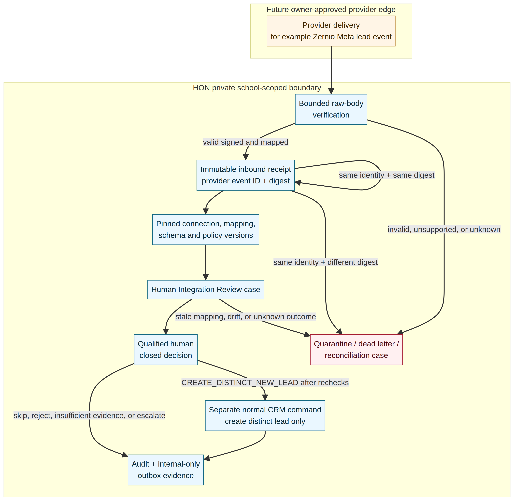
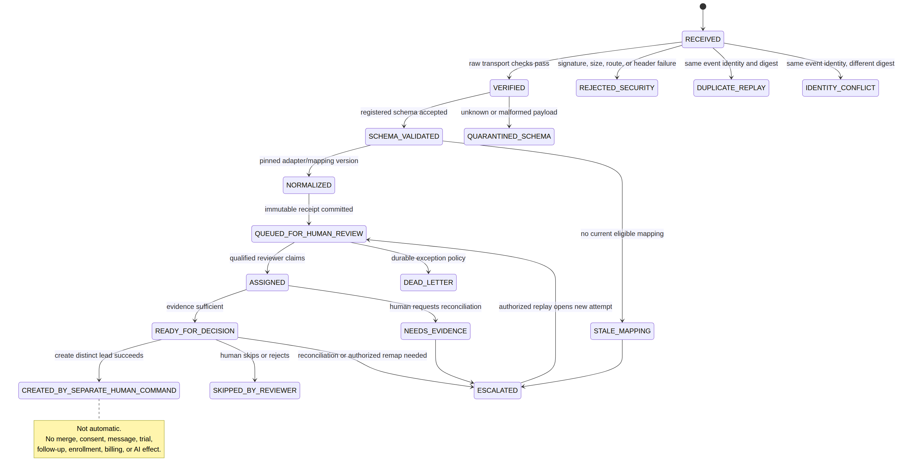

# Phase 2A — Human-Confirmed Integration Ingress Design

**Status:** Design-only owner-review proposal. This document creates no schema, API, credential, provider connection, webhook endpoint, OAuth handoff, message, AI task, payment, deployment, or external effect.

## Decision

HON should prepare a **provider-agnostic, evidence-first inbound integration boundary**. Its safe future path is:

```text
signed raw inbound delivery
  → immutable tenant-scoped receipt and dedup evidence
  → pinned connection/mapping/schema/policy versions
  → private human Integration Review case
  → separately authorized normal CRM command
  → audit and internal-only outbox evidence
```

The boundary is deliberately not a shortcut into public-form intake, CSV import, payment webhook handling, direct CRM creation, Action Engine execution, communications, or AI. It must not auto-create a lead, merge a person, assign ownership, create consent, schedule a trial, create a follow-up, send a message, enroll a student, create a membership, bill, call a provider, or invoke an AI employee.

The architecture follows the Phase 2 readiness assessment's recommendation that provider material first become durable, school-scoped evidence and then receive human review. Existing website forms, campaign attribution, Migration Center, trials, follow-ups, Chad, and the Lead Sources monitor keep their current boundaries unchanged.

## Diagrams



[Mermaid source](../diagrams/phase-2a-integration-ingress.mmd) · [Rendered PNG](../diagrams/phase-2a-integration-ingress.png)



[Mermaid source](../diagrams/phase-2a-integration-review-state.mmd) · [Rendered PNG](../diagrams/phase-2a-integration-review-state.png)

## What the evidence establishes

Zernio documents a Meta `lead.received` webhook with a stable event ID, Meta `leadgenId`, form identifier, fields, and selected ad/account context. It also documents at-least-once delivery, five-second acknowledgement expectations, retry/dead-letter behavior, and an HMAC-SHA256 signature over the raw request body.[1] [2] This is useful feasibility evidence, not proof that HON has a connection, account authorization, Page/form mapping, signing secret, valid consent, working delivery, or operational health.

Zernio connection material describes a selected-Page step for Meta lead forms and notes that reconnect behavior and account identifiers may change. A lead payload carries a form ID but not a Page ID, so HON must not route a delivery to a school from a form name, account label, campaign, or source string alone.[3] [4] The future connector must resolve a stored, versioned mapping from private server-side evidence.

The current HON implementation has a strong provider-free CRM foundation, but it intentionally has no provider connection object, secret reference, signed webhook transport, provider event ledger, mapping model, reconciliation model, or human integration-review queue. [Phase 2 CRM Integration Readiness Assessment](../assessments/PHASE_2_CRM_INTEGRATION_READINESS.md) is the current baseline.

## Proposed private data model

The names below are design names, not approved migrations. Every durable row is organization-and-school scoped, uses a composite relation to the owning school, and is inaccessible by direct runtime/browser table access.

### Connection and credential metadata

`integration_connections` represents one historical binding to a provider. It contains an immutable HON connection identity, `organization_id`, `school_id`, normalized provider code, lifecycle state, credential rotation/revocation metadata, approved scope-set version, and timestamps. It stores **opaque secret-manager references only**. Refresh tokens, authorization codes, webhook secrets, raw secret references, provider inventory, and tokens do not appear in ordinary tables, audit payloads, outbox payloads, URLs, logs, receipts, or browser state.

A redacted server projection may expose only whether a credential is configured and a response-backed lifecycle state. It may not expose the secret reference, token expiry value, account inventory, raw provider error, or an unverified health claim.

Connection lifecycle is append-only/versioned. Proposed lifecycle facts are `PROPOSED`, `CONNECTING`, `CONFIGURED`, `PAUSED`, `REVOKED`, `DISCONNECTED`, and `ERROR`. Connect, reconnect, rotation, disablement, disconnect, and kill-switch operations need an expected-version check, actor-bound idempotency, current live authorization, audit evidence, and internal-only outbox evidence. Disconnect or revocation prevents new mapping resolution immediately while preserving history.

### Versioned provider asset mapping

`integration_mappings` binds exactly one current connection to one school and one normalized provider asset tuple. For Zernio/Meta that tuple is conceptually provider profile/external identifier, account context, selected Page, and form identifier. It also records the approved non-terminal CRM pipeline/stage, optional current ACTIVE campaign snapshot, policy/schema/adapter version, validity window, and mapping lifecycle.

A current mapping must be unique across schools for the normalized asset tuple. A partial uniqueness rule or equivalent fixed-function guard prevents one provider account/Page/form from having two active school mappings at the same time. Mapping edits append a new version. They never rewrite an earlier receipt or silently reinterpret a retry under the newest mapping.

Mapping a campaign uses current-school `marketing.campaign.attribute` authority and requires an ACTIVE campaign at the moment the mapping version is created. A campaign snapshot remains source provenance only. It never proves ad spend, delivery, conversion, enrollment, payment, revenue, or ROI.

### Immutable inbound evidence

`integration_inbound_receipts` is the first durable fact after a future signature-valid inbound request. It stores only bounded metadata: provider, connection/mapping identity and versions, external event ID, event type, provider timestamp, receipt timestamp, raw-byte digest, normalized-payload digest, schema/adapter version, verification key/version identifier, and a redacted resolution outcome.

A unique identity is proposed as `(provider, connection_id, external_event_id)`. The same identity with the same verified digest is a replay and returns its recorded receipt outcome without new work. The same identity with a different digest becomes immutable `IDENTITY_CONFLICT`/quarantine evidence, never an overwrite or remap.

`integration_payload_evidence` is optional and exists only if the owner later approves an explicit minimization, encryption, retention/deletion, regional-processing, and access policy. It is a separate forced-RLS private vault. Raw provider bodies, fields, contact values, consent text, form labels, and error blobs never enter normal CRM source facts, audit records, outbox events, browser responses, or routine queue lists.

### Human review and decisions

`integration_review_cases` refers to a specific receipt/evidence version and provides the private review lifecycle. Proposed states are `QUEUED`, `ASSIGNED`, `NEEDS_EVIDENCE`, `DUPLICATE_CANDIDATE`, `READY_FOR_DECISION`, `SKIPPED`, `REJECTED`, `ESCALATED`, `STALE_MAPPING`, `DEAD_LETTER`, and `RESOLVED`.

`integration_review_decisions` is append-only. A qualified human binds an exact receipt, mapping version, normalized evidence version, candidate projection, policy version, expected case version, reviewer capability, rationale code, and expiry. A reviewer-owned short-lived capability is a control plane for review, not a general person/lead lookup.

The conservative decision set is:

- `CREATE_DISTINCT_NEW_LEAD`
- `SKIP_OR_REJECT`
- `INSUFFICIENT_EVIDENCE`
- `ESCALATE_OR_RECONCILE`
- `REMAP_WITH_SEPARATE_AUTHORIZATION`

`ATTACH_TO_EXISTING_LEAD` is intentionally **not approved by this design**. It remains an owner/domain decision because it could blur the no-merge, no-source-rewrite, and no-ownership-mutation guarantees. Any future attach path requires a separate contract proving it is neither a merge nor a record mutation.

## Authorization and RLS model

The server resolves current scope from the verified human principal. It does not accept organization, school, provider, mapping, actor, role, or authority from a browser selector, URL, webhook claim, or GUC supplied by the caller.

A proposed dedicated fixed resolver follows the existing exact-one public-form/campaign pattern:

```text
verified HUMAN_USER/HUMAN_UI principal
  → one active organization/school candidate
  → live role + permission + entitlement check
  → exact-one scope or no result
```

Zero or multiple eligible schools fail closed. The generic resolver that accepts a caller-selected school ID is not suitable for provider lifecycle commands. A command locks and rechecks organization → school → user → principal → grants → roles → permissions → entitlement, with a live clock after lock/idempotency waits.

Proposed separate capabilities are:

- `marketing.integration.status.read`
- `marketing.integration.connection.manage`
- `marketing.integration.mapping.manage`
- `marketing.integration.reconciliation.manage`
- `crm.integration_review.read`
- `crm.integration_review.decide`
- existing normal CRM create authority for the separately invoked lead command

Connection lifecycle is for a school owner or an explicitly approved delegated role. Mapping, reconciliation, and review are separate sensitive permissions. Parent/family, public, HQ-derived, nonhuman, AI, Action Engine, generic service, and cross-school contexts are denied by default unless a future approved contract explicitly narrows an exception.

All proposed connection, mapping, receipt, payload-vault, review, decision, and reconciliation tables use `ENABLE ROW LEVEL SECURITY` and `FORCE ROW LEVEL SECURITY` with no direct runtime/client policies or grants. Only minimal named SECURITY DEFINER functions belong in the runtime allowlist. Helpers, triggers, history functions, secret references, and raw payload access remain uncallable by `hon_runtime`, `PUBLIC`, and browser-facing roles. The canonical runtime grant and verifier files must receive matching negative ACL/RLS/function/search-path checks when and only when a future implementation is approved.

## Future inbound transport contract

The future endpoint is a provider-only transport boundary, not a browser API. Its exact route is deferred until an implementation PR because route registration is itself a security review decision.

The intended behavior is:

1. Accept only a registered method, content type, content encoding, header allowlist, body limit, and event allowlist.
2. Read bounded raw bytes before any JSON parsing.
3. Validate the provider-specific signature in constant time against the server-side secret reference and validate timestamp/nonce/replay rules where the provider supplies them.
4. Reject malformed, unsigned, misbound, oversized, unsupported, test, or unknown-mapping payloads into bounded security/quarantine handling. Invalid signatures create no CRM/audit/outbox business fact.
5. Atomically reserve a receipt and dedup result before acknowledgement. A 2xx response occurs only after that durable result commits.
6. Create only a private review case and redacted internal evidence after a valid, resolved receipt. No CRM mutation is part of acknowledgement.

For Zernio specifically, the implementation must verify the raw-body HMAC-SHA256 signature, honor at-least-once delivery, use the stable event ID for deduplication, retain `leadgenId` as a secondary reconciliation key, and keep any `formName`, ad, ad-set, campaign, or field value out of routing decisions.[1] [2] A healthy-looking connection is not delivery evidence: Zernio documents that a Page can lose lead-generation subscription while other traffic continues.[1]

## Human Integration Review flow

```text
receipt is verified and mapped
  → private case is queued
  → qualified human explicitly loads bounded case detail
  → system presents redacted candidate and advisory duplicate suggestions
  → human chooses a closed decision
  → separate normal CRM command rechecks case/evidence/authority/version
  → either one distinct new lead is created, or no CRM change occurs
```

Duplicate matching is advisory and school scoped. It may consider normalized email/mobile and reviewed provider-native identifiers, but it may not auto-merge, suppress, alter an existing person/lead, change source facts, assign a lead owner, or advance lifecycle. A suggested match is not identity proof.

The later CRM create command is separate from inbound receipt processing. It rechecks the review decision, mapping/evidence/case versions, current school authority, entitlement, non-terminal target stage, and idempotency. It atomically creates one distinct CRM lead with minimized immutable provenance, a redacted audit record, internal-only outbox evidence, and an idempotency receipt. It uses an inert integration-review event type—not a generic `crm.lead.created` event—until a future consumer policy is reviewed.

## Provenance, consent, and no-effect rules

A lead source should be a closed short code such as `META_LEAD_FORM`, within the existing source bound. Private source facts can preserve provider, receipt, mapping, adapter/schema versions, provider asset identifiers, selected campaign snapshot, source digests, and receipt/provider timestamps. None of these source facts establishes customer identity, ownership, ad spend, consent, conversion, enrollment, payment, revenue, or ROI.

A provider checkbox, acknowledgement, email, phone, or form field is an unverified provider claim. It cannot create HON SMS/email/push consent. Any later communication requires the existing separately governed consent and message queue/delivery path with live recipient/channel consent checks.

The following effects are expressly absent from Phase 2A:

- provider connection, OAuth, webhook registration, polling, lead retrieval, or API call
- automatic CRM lead create, merge, attach, close, assignment, scoring, trial, follow-up, or automation
- communication consent, message drafting, queueing, delivery, or customer contact
- ad creation, spend, conversion, revenue, ROI, payment, credit, membership, enrollment, or billing effect
- AI invocation, AI work creation, Action Engine request, approval, execution, or provider use
- browser persistence of sensitive facts, credentials, candidate data, retry keys, or selected scope

## Closed contract overview

These are proposed closed schemas, not implemented endpoints. Their future route names, marker headers, function names, and permissions require a separate contract review. Every browser-facing read is same-origin, `no-store`, response-validated, server-scoped, and redacted. Unknown properties fail validation rather than widening a projection.

### Staff status read

`IntegrationStatusProjection` may contain only an opaque HON connection reference, provider code, stored connection lifecycle, boolean credential-configured state, mapping readiness state, bounded reconciliation state, and server-approved timestamps/version labels. It never carries a token, secret, account inventory, raw provider identifier, raw provider error, payload, lead data, spend, health claim, or delivery claim.

### Mapping review and command

`IntegrationMappingProjection` may contain opaque connection/mapping references, provider display label, lifecycle, destination pipeline/stage display labels, optional ACTIVE campaign display label, current mapping/schema/policy version, and permitted capability flags. The future `IntegrationMappingCommand` binds the opaque mapping reference, expected version, closed non-terminal destination selection, optional campaign reference, exact human confirmation literal, and an idempotency key. It accepts no school, organization, actor, provider credential, free-form field map, lead-owner, consent, provider-account browser, or authority selector.

### Review list, detail, and decision

`IntegrationReviewListRequest` permits only closed provider/lifecycle/review-state/reason filters, a bounded UTC range, an opaque cursor, and a small page size. `IntegrationReviewDetailProjection` returns only a qualified reviewer's redacted candidate facts, immutable evidence/mapping/schema/policy version labels, bounded duplicate suggestions, safe blockers, and decision receipt—not raw payloads, contact directory data, secrets, audits, outbox internals, or provider blobs.

`IntegrationReviewDecisionCommand` binds the opaque case reference, expected case/evidence version, closed decision enum, exact confirmation literal, reviewer-owned review capability, and idempotency key. The initial enum excludes `ATTACH_TO_EXISTING_LEAD`. `CREATE_DISTINCT_NEW_LEAD` invokes a separate canonical direct-human CRM command after a live reauthorization, never inside the inbound acknowledgement transaction.

### Provider transport

`InboundProviderEnvelope` is server-only and starts as bounded raw bytes plus an exact provider integration code, route/method/header/content metadata, and provider verification context. It is not a browser JSON contract. Its durable result is a minimal `InboundReceiptOutcome` with opaque receipt reference, replay/conflict/quarantine/review outcome, and safe retry/acknowledgement behavior. The raw body and signature material remain private transport evidence.

## Reconciliation, exceptions, and kill switch

A later operational design must reconcile three planes: provider inventory/cursor against receipt evidence; receipts against normalized/review cases; and review decisions against CRM creation/audit/outbox evidence. It must surface redacted exception cases for missing, delayed, duplicate, reordered, dead-lettered, disconnected, needs-reconnect, schema-drift, mapping-drift, and unknown-outcome conditions.

A future `REPLAY_FROM_EVIDENCE` operation is human-authorized. It references the original immutable receipt, records a reason, binds either the original mapping or an explicitly authorized remap, and creates a new replay-attempt record. It may only reopen or create a review case. It may not directly create or merge CRM data.

A school-scoped kill switch pauses mapping resolution and downstream case creation. It does not delete evidence, silently reassign events, or pretend the provider is healthy. Reconnect requires a new current authorization and revalidation of scope, mapping, policy, and provider-side prerequisites.

## Required proof gates before any implementation

A future implementation must provide fresh disposable-local evidence for:

1. Forced RLS, ACL, helper/function, trigger, and secret-redaction drift across every private integration table.
2. Exact-one human scope; two-school and cross-organization ambiguity; parent/HQ/nonhuman/service denial; entitlement/role/permission revocation during lock waits.
3. Valid, missing, malformed, tampered, misbound, stale, compressed/oversized, unsupported-type, and unsupported-schema inbound transport cases.
4. Same-ID/same-digest replay, same-ID/different-digest conflict, concurrent delivery, reordered delivery, mapping drift, disconnect/reconnect, and unknown-outcome cases.
5. Review-token expiry, expected-version conflict, stale mapping/evidence, duplicate suggestion, never-merge, atomic rollback, idempotency, and reviewer reauthorization.
6. Full no-effect snapshots across consent, messages, scheduling, trials, enrollment, membership, invoices, payments, attendance, AI usage/work, Action Engine, provider calls, browser storage, and external egress.

## Owner decisions required before any connector implementation

1. Whether provider raw payloads may be retained at all, and the approved minimization, encryption, retention/deletion, region/processor, and access policy.
2. The delegated-role model for connection, mapping, reconciliation, review, and eventual CRM disposition.
3. Mapping cardinality and remap policy for provider account/Page/form assets, reconnects, retired forms, and campaign snapshots.
4. Whether `ATTACH_TO_EXISTING_LEAD` is ever allowed; the safe default is not to implement it.
5. The inbound review policy for test events, invalid-signature telemetry, schema drift, delayed/replayed events, dead letters, reconciliation cadence, and kill switch.
6. The evidence required before provider activation: authorized account/Page/form ownership, permitted scopes, selected-Page proof, secret custody, endpoint-limit clarification, and sandbox/cost approval.
7. The fixed permission names, review states, audit/outbox event names, and explicit no-consumer policy for the first implementation slice.

## References

[1]: https://docs.zernio.com/webhooks "Zernio webhooks"
[2]: https://docs.zernio.com/webhooks/ads "Zernio ads webhooks"
[3]: https://docs.zernio.com/platforms/meta-ads/connect "Zernio Meta Ads connection"
[4]: https://docs.zernio.com/platforms/meta-ads/lead-forms "Zernio Meta lead forms"
[5]: https://docs.zernio.com/guides/error-handling "Zernio error handling"
