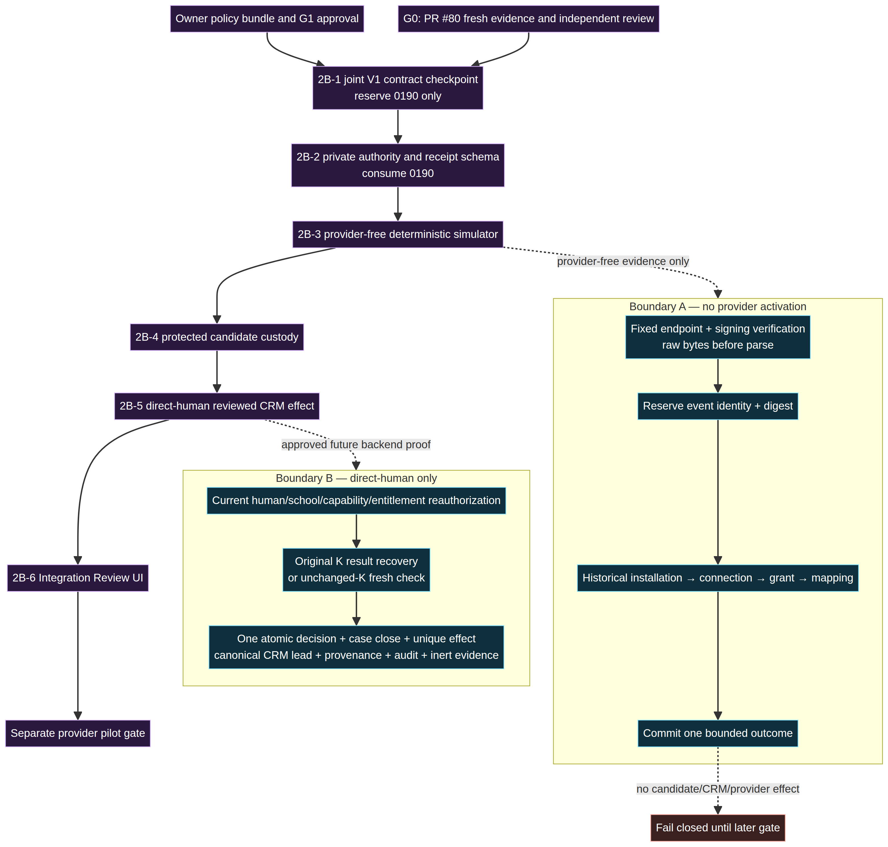

# Phase 2B Joint Contract Checkpoint

**Status:** Documentation-only contract checkpoint; no implementation authorization.

**Baseline:** Canonical `main` at `780424c72f226123ad078b74b432d8dc9d8dbd5f` (merged META-1 / PR #79 and merged Phase 2A documentation). This record does not claim fresh runtime verification.

**Version:** `HON-INTEGRATION-V1.0.0-proposed`



## Purpose and current no-go

This document is the joint Manus/Codex contract to review before any inbound integration, school connection, protected candidate, CRM effect, or Integration Review UI implementation. It is deliberately provider-neutral. It does not add a migration, runtime code, provider capability, credential, sandbox account, webhook, event route, browser route, customer data, or business effect.

The owner approved a narrow exception to retain the existing HQ-only Zernio source foundation in PR #80. That source remains disabled and unused. `HON_ZERNIO_VERIFICATION_APPROVED` must remain absent or false; `ZERNIO_API_KEY` must not be configured or used; the verification path must not run. Retention is not approval for credential use, provider operation, connection, mapping, ingress, data custody, CRM mutation, AI work, or deployment.

No Phase 2B runtime work is authorized until both gates are satisfied:

- **G0 — #80 evidence/review:** Codex reconciles #80 against this baseline, records fresh exact-head evidence, and receives independent review. Regular draft CI skips must be reported as skips, not passes.
- **G1 — joint authorization:** the owner approves the policy bundle in [Owner decisions](#owner-decisions), and Manus and Codex approve this version, the code-boundary map, transaction lock order, and the single migration reservation.

## Contract planes

Each plane owns its state. A field or status in one plane must not silently create authority in another.

| Plane | Proposed V1 record | Scope and purpose | Explicitly not authority for |
| --- | --- | --- | --- |
| Installation | `IntegrationInstallationV1` | Platform-registered provider integration and bounded endpoint/key-generation eligibility | School selection, candidate identity, provider-data API use, CRM effect |
| Private binding | `CredentialBindingReferenceV1` | Opaque, purpose-scoped reference and version to approved private custody | Raw secret disclosure, vault location, school connection, asset permission |
| School connection | `SchoolProviderConnectionV1` | Historical, school-scoped lifecycle relationship to an installation | A school asset grant, default routing, browser selection, CRM authorization |
| Exact grant | `SchoolProviderAssetGrantV1` | Exact profile/account/Page/form capability grant with immutable grant history | Wildcard school or organization authority, current-mapping fallback |
| Mapping | `HistoricalMappingRevisionV1` | Time-bounded source asset to school connection/grant evidence | Rewriting received-event history or changing dedupe namespaces |
| Ingress receipt | `InboundReceiptV1` | Minimal signed-event identity, canonical digest, routing result, and bounded outcome | Candidate display, lead creation, provider API permission |
| Source occurrence | `IntegrationSourceOccurrenceV1` | Stable, mapped lead-occurrence identity distinct from a delivery attempt | Duplicate attach/merge, alternate lead creation |
| Review case | `IntegrationReviewCaseV1` | Human review state and minimal metadata projection | Automatic execution or stored protected candidate data |
| Disposition request | `IntegrationDispositionRequestV1` | Original direct-human command `K`, fingerprint, frozen scope, and durable result | A new retry key or delegated/AI authority |
| CRM effect | `IntegrationCrmEffectV1` | Unique source-occurrence-to-canonical-lead provenance/result | Outbox, automation, Action Engine, or provider dispatch authority |
| Browser lifecycle | `IntegrationReviewBrowserStateV1` | Ephemeral response/cache concealment and recovery state | Durable evidence, background retry, authority, or persistence |

All ordinary database rows remain organization/school composite-scoped where applicable, subject to FORCE RLS, least privilege, fixed-function boundaries, immutable history, and redacted audit evidence.

## Closed V1 record contracts

The joint checkpoint must publish exact TypeScript/JSON-schema-equivalent closed validators before any schema or API PR. They must reject extra, inherited, accessor-backed, wildcard, secret, raw-body, provider-error, unapproved candidate, or authority-escalating fields.

### Installation and credential custody

```text
IntegrationInstallationV1
  installationId (server generated)
  providerKind (closed enum)
  endpointKind (closed enum)
  signingKeyGenerationId (opaque historical selector)
  lifecycle (disabled | proposed | active-for-synthetic-test | revoked)

CredentialBindingReferenceV1
  bindingId (opaque)
  purpose (webhook-signature | provider-data-operation)
  keyVersion (opaque version, not material)
  lifecycle (proposed | active | rotated | revoked | disabled)
  custodyPolicyVersion
```

A valid signature authenticates only bounded raw bytes under a fixed, registered endpoint and eligible historical signing-key generation. The resolver may run before tenant routing solely for that signing purpose. It cannot derive a key from an untrusted school/profile/body selector, enumerate tenants, expose material, or confer school, candidate, CRM, asset-grant, or provider-data authority.

Provider data/API operation resolution is separate. It requires a verified school connection, exact asset/capability grant, current server authorization, correct purpose, lifecycle, and a post-lock recheck. Signing material and provider-operation material are non-substitutable.

### Connection, grant, and mapping

```text
SchoolProviderConnectionV1
  organizationId + schoolId (immutable composite scope)
  connectionId
  installationId
  credentialBindingId (opaque only)
  lifecycle and lifecycleVersion

SchoolProviderAssetGrantV1
  grantId
  connectionId
  providerAssetKind + providerAssetOpaqueReference
  capabilitySet (closed allowlist)
  grantLifecycle and grantVersion

HistoricalMappingRevisionV1
  mappingRevisionId
  grantId
  sourceAssetOpaqueReference
  effectiveFrom / effectiveUntil
  mappingVersion
```

A provider account, profile, Page, form, URL, browser selector, present mapping, current default, or external ID never chooses a tenant. Tenant routing resolves only a historically valid, exact installation → connection → grant → mapping chain. A delayed first-seen event from A after a later A→B remap retains its historical A evidence. If no single historical mapping is provable, it must not enter a school queue.

### Receipt, review, and effect

```text
InboundReceiptV1
  installationId + stableProviderEventIdentity
  canonicalDigest
  sourceOccurredAt (if safely normalized)
  historicalMappingRevisionId (nullable only for non-school quarantine)
  routingOutcome
  receiptVersion

IntegrationReviewCaseV1
  reviewCaseId
  sourceOccurrenceId
  state
  metadataProjectionVersion
  currentVersion

IntegrationDispositionRequestV1
  requestId (original command K)
  reviewCaseId + sourceOccurrenceId
  actorPrincipalId + frozen organizationId + frozen schoolId
  commandFingerprint + confirmationLiteral
  resultReference

IntegrationCrmEffectV1
  sourceOccurrenceId (unique)
  canonicalLeadId
  provenanceVersion
  resultVersion
```

The initial allowed dispositions are `CREATE_DISTINCT_NEW_LEAD`, `SKIP`, `REJECT`, `INSUFFICIENT_EVIDENCE`, `ESCALATE`, and `REQUEST_AUTHORIZED_REMAP`. There is no attach, merge, update, assignment, trial/follow-up, enrollment, payment, message, Action Engine, AI, automation, or Verified Auto-Create disposition in V1.

## Ingress outcomes and Boundary A

The provider-free ingress simulator and later adapter must distinguish six outcomes. All are fail-closed; none creates a CRM lead or exposes unresolved input to a school.

| Outcome | Durable handling | School visibility | Acknowledgement rule |
| --- | --- | --- | --- |
| `SIGNATURE_REJECTED` | Bounded security telemetry only; no parsed body | None | Permanent rejection response; no school write |
| `MALFORMED_REJECTED` | Minimal validated failure code after signature verification | None | Permanent rejection response; no business write |
| `UNSUPPORTED_VERSION_QUARANTINED` | Metadata-only operator-plane outcome if approved | None by default | Acknowledge only after the bounded outcome commits |
| `UNKNOWN_BINDING_QUARANTINED` | Metadata-only operator-plane outcome if approved | None | Acknowledge only after durable bounded outcome; otherwise reject |
| `AMBIGUOUS_BINDING_QUARANTINED` | Metadata-only operator-plane outcome if approved | None | Acknowledge only after durable bounded outcome; otherwise reject |
| `RETRY_AMBIGUOUS_RECONCILIATION_REQUIRED` | Durable retry/reconciliation state using original identity | None until reconciliation | Do not issue a fresh effect or new identity; adapter response follows approved reconciliation policy |

**Boundary A order is fixed:** fixed endpoint and signing key generation → bounded raw-byte signature verification before parse → event identity reservation → canonical digest replay/conflict classification → historical routing → one durable bounded outcome → adapter response. No provider acknowledgement may precede the durable outcome.

A same identity/same digest returns the original receipt result. A same identity/different digest is an immutable conflict. Reconnect, remap, and retry never create a new deduplication namespace.

## Boundary B: direct-human review and one canonical CRM lead

Boundary B is separate from ingress and direct-human only. It does not receive a provider call, process raw payloads, or infer consent/identity.

1. Reauthorize the current human, organization, school, capability, entitlement, case state, and original command `K` before any effect.
2. If `K` has a committed durable result, return that exact scoped result after access reauthorization even if the case version advanced because of `K`. Do not create a new request, decision, lead, audit, outbox, or inert evidence event.
3. If no durable result exists, run fresh checks with unchanged `K`.
4. In one transaction, commit review decision/case closure, unique source-occurrence effect reservation, canonical CRM lead creation, scoped provenance/result, redacted audit, and structurally inert integration evidence.
5. On any failure, roll everything back. No partial person, lead, decision, effect, audit/outbox, or receipt is acceptable.

The canonical CRM create path must be extracted as a separately reviewed, transaction-aware internal primitive. The existing direct-human `LeadService.create` behavior and ordinary `crm.lead.created` v1 contract remain unchanged. The integration evidence event must be structurally non-dispatchable: it cannot be claimed by outbox, automation, Action Engine, AI, communications, or generic consumers.

### Lock ranks

Exact SQL relation names are implementation work, but the lock rank is a contract requirement:

| Rank | Boundary A | Boundary B |
| --- | --- | --- |
| 1 | Installation/event-identity reservation | Original disposition request `K` |
| 2 | Digest conflict/replay classification | Review case/version |
| 3 | Historical mapping revision evidence | Source occurrence |
| 4 | Receipt/outcome | Unique CRM effect reservation |
| 5 | — | Canonical lead duplicate/provenance guard |
| 6 | — | Audit + structurally inert evidence in the same atomic change |

Post-wait lifecycle, grant, mapping, case-version, permission, and entitlement checks are mandatory. A stale read is not authority.

## Ownership and first conditional PR

| Work | Manus | Codex | Owner/security gate |
| --- | --- | --- | --- |
| G0 | Independent review of evidence | Reconcile and complete #80 evidence; keep source disabled | Exact-head review required |
| 2B-1 | Contract/recovery/CRM boundary review | Installation/credential/ingress boundary review | Joint approval of V1 + lock ranks + reservation |
| 2B-2 | Review RLS/provenance/no-effect tests | Implement private authority/receipt schema | Custody, mapping, role policy; consume only `0190` |
| 2B-3 | Review simulator/no-effect proof | Implement provider-free deterministic simulator | Synthetic fixture/cutover policy |
| 2B-4 | Candidate/review semantics and no-CRM leakage | Custody/infrastructure boundary | PII/KMS/region/retention/backup/deletion policy |
| 2B-5 | Implement review/disposition and canonical CRM primitive | Contract review | Reviewer, source/stage, duplicate, inert-consumer policy |
| 2B-6 | Recovery/API compatibility review | UI implementation | Backend proof plus visual-collaboration clearance |

**First PR to authorize, conditionally:** **2B-1 — Joint Versioned Contract Checkpoint**. It may begin only after G0/G1. It is contract-and-test documentation only, reserves `0190`, and contains no SQL/DDL, persistence, controller, route, resolver, provider/network code, candidate value, UI, CRM mutation, payment, AI, or activation.

## Owner decisions

Recommended defaults are conservative and remain decisions, not implementation.

1. **Credential custody:** use one approved private facility; binding references are opaque; signing and provider-operation keys remain purpose-separated; default deny on rotation/revocation/cutover mismatch.
2. **Asset grant/remap:** one exact asset grant at a time per connection/capability; immutable historical mapping revisions; default deny for unknown or ambiguous historical evidence.
3. **Operator quarantine:** permit only a separate platform operator plane with metadata-only, redacted, retention-bounded records; default deny school visibility.
4. **Raw/candidate data:** retain no raw body by default. Do not persist any protected candidate field until explicit field allowlist, KMS/region/retention/backup/deletion approval.
5. **Review and duplicate policy:** default `CREATE_DISTINCT_NEW_LEAD` only, no attach or merge, human confirmation required.
6. **Provider pilot:** no sandbox or live pilot without separate vendor/account, cost, monitoring, kill switch, reconciliation staffing, incident, capacity, and legal/privacy approval.

## Codex coordination request

Codex should review this exact contract checkpoint after completing G0, specifically: the retained #80 source remains disabled; credential-purpose separation; the pre-tenant signing limitation; historical mapping/routing; lock ranks; the `0190` reservation; and no provider-activation interpretation. Manus and Codex should publish one signed-off contract version before the owner is asked to authorize 2B-1.

## Documentation validation

The Mermaid source rendered successfully. Required contract terms and all relative internal links were checked, `git diff --check` passed, and an independent read-only audit found no blocker or material ambiguity in the no-go, authority, lock, migration, ownership, simulation, or payment-separation boundaries. This is not application, database, provider, payment, or deployment validation; no such run is claimed for this documentation-only branch.

## Related records

- [Phase 2A ingress design](PHASE_2A_INTEGRATION_INGRESS_DESIGN.md)
- [Phase 2A state vocabulary](PHASE_2A_INTEGRATION_STATE_VOCABULARY.md)
- [Phase 2A verification and rollout](PHASE_2A_INTEGRATION_VERIFICATION_AND_ROLLOUT.md)
- [Provider-free simulation plan](PHASE_2B_PROVIDER_FREE_SIMULATION_PLAN.md)
- [Phase 2B PR sequence](PHASE_2B_IMPLEMENTATION_SEQUENCE.md)
- [Pitbull Payments Adapter requirements](PITBULL_PAYMENTS_ADAPTER_REQUIREMENTS.md)
