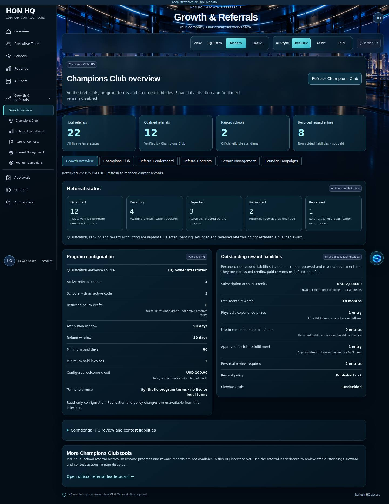
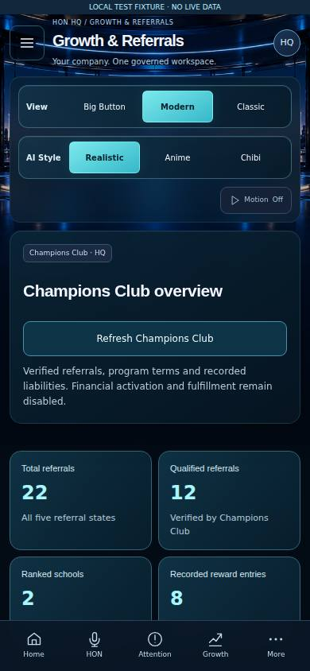
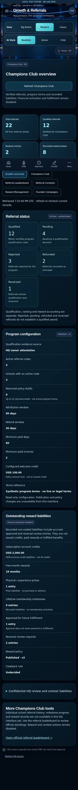

# HON HQ Champions Club — actual application review

These are real application screenshots from the production Next.js build, **not generated concepts**. Every displayed number, program term and school is a visibly labeled synthetic localhost fixture. No live customer data, production database, paid provider, reward issuance or deployment was used.

**Verified source:** `14e02b37bcbc6cbc5a76d1a077224c6872bdf4f6`, based on accepted main `512eddbcc0c3809207d7cff7648893b6ee1a3323`. PR #19: `codex/hq-champions-management`.

- [Standard CI 39158351246](https://github.com/myhonosai/honos/actions/runs/39158351246): both jobs passed; 590 web / 408 API / 188 domain / 91 auth tests, typecheck/build, 155 migration-file checks; all 13 disposable-local database proofs, including forced RLS on 227 tables.
- [Actual-app browser 39158351200](https://github.com/myhonosai/honos/actions/runs/39158351200): **53 checks passed, zero failures**, 33 PNG captures, 16 axe scans with zero reported violations. [Sanitized report](browser-report.json).
- [Full capture artifact](https://github.com/myhonosai/honos/actions/runs/39158351200/artifacts/12147937447): desktop/tablet/mobile/320px; existing HQ, leaderboard and assistant regressions; overview, empty, denied and unavailable states. Artifact expires October 21, 2026. The JPEGs below are the browser's unedited JPEG captures and remain committed for review.

## Desktop — 1440 × 1000 viewport, full page

## Mobile — 390 × 844 viewport

Totals and refresh are accessible near the top. View and AI Style retain separate boundaries. The compact desktop assistant has its own gutter; mobile uses the approved bottom HON control.

## Mobile — full page

The fixed bottom navigation appears at its original viewport boundary in full-page captures. The browser checked scrolling bounds, all three views, assistant expansion, keyboard controls and focus restoration. The viewport image shows what fits on the actual screen.

## Functional scope and limits

`/hq/growth` and `/hq/growth/champions-club` read real M5 overview and M1 program APIs. The existing leaderboard remains functional. This first slice does not implement school selection/history/milestones or individual reward-ledger filters. Complete school reward history requires the HQ contract coordination recorded in the handoff; the school-staff rewards endpoint is not reused from HQ. No paid/issued/fulfilled reward state is invented.

An initial exact-text browser selector failed because an amount shared its field with explanatory text; it was corrected, including stale-data assertions. Screenshot review then improved mobile hierarchy and reserved space for the persistent assistant. Final results above are from the refined source.

Manual review remains: physical iOS/Android keyboards/rotation, VoiceOver/NVDA announcements/focus, contrast/zoom and 1–2 axe incomplete rules per scan. Automated zero violations do not establish complete WCAG conformance. External browser hosts, including remote fonts, were blocked. No source or approved artwork was changed by the capture process.
