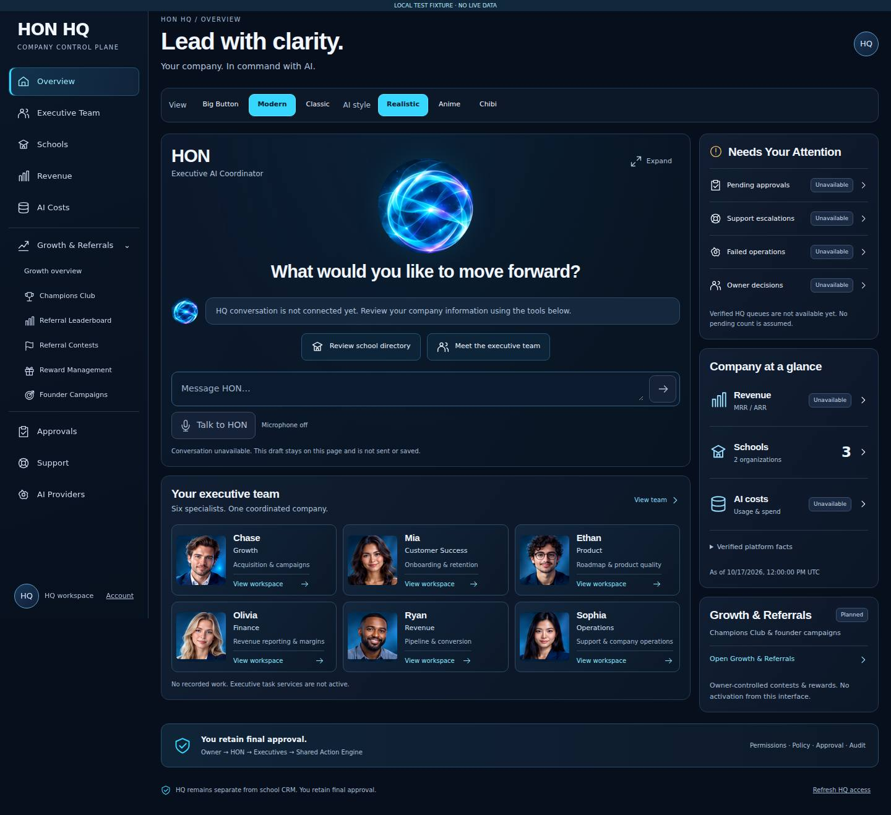
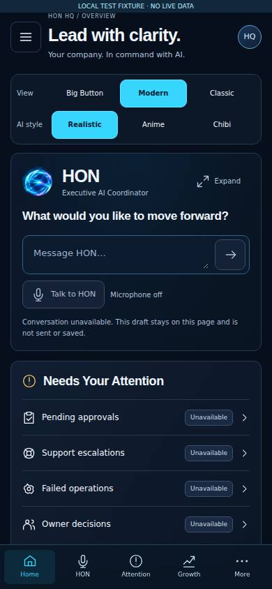

# HON HQ — real browser review

These are screenshots of the **implemented Next.js production build**, not generated concept images. Every image is labeled **LOCAL TEST FIXTURE · NO LIVE DATA**. The two organization / three school counts are synthetic contract fixtures, not company metrics.

Verified application source: [`c71b6fb`](https://github.com/myhonosai/honos/commit/c71b6fb1cedb837909692c98de1f6a74c7f57446). The screenshot/documentation commit does not change application code.

## Desktop and mobile

[Desktop full resolution](desktop.jpg) · [Mobile viewport](mobile.jpg) · [Mobile full page](mobile-full.jpg)

These JPEG review copies retain the original screenshot dimensions (1440px desktop, 390px mobile). Full-page mobile capture places the fixed navigation at the initial viewport position; use the viewport image to assess the actual visible screen.

## Executed verification

[Browser run](https://github.com/myhonosai/honos/actions/runs/39103263735): **36 passed, 0 failed**. [Sanitized report](browser-report.json).

[Existing CI](https://github.com/myhonosai/honos/actions/runs/39103263609) on the same source passed both jobs: `pnpm test`, `pnpm check`, `pnpm build`, migration-file checks, clean tracked-source checks and disposable-local PostgreSQL security proofs. No migration was added or applied to a shared database.

[Private artifact: all 18 PNG screenshots and reports](https://github.com/myhonosai/honos/actions/runs/39103263735/artifacts/12127426706). The artifact expires after three days; these selected repository images remain available on this branch.

| Area | Actual result |
| --- | --- |
| Responsive layouts | No horizontal overflow at 1440×1000, 834×1112, 390×844 and 320×800, including all three view modes |
| Portrait styles | Six canonical identities retained; Realistic and Chibi render; Anime explicitly awaits approved artwork |
| Assistant | Expand/minimize, unsent draft continuity, mobile focus containment, Escape and opener-focus restoration pass; send and microphone remain disabled |
| Navigation | Executive workspace/tabs, mobile drawer and all Growth navigation entries pass; contest preview cannot launch an action |
| Accessibility | Eight WCAG-tagged axe scans, zero reported violations; one or two incomplete rules per scan still require human review |
| Access states | Unsigned session redirects to login; 401, 403, 503 and malformed overview responses hide HQ content |
| Network/runtime | No browser JavaScript errors; fixture API received only allowlisted GET reads; external font requests blocked |

The browser uses the real signed-session layout gate with a randomly signed disposable session. A localhost fixture server supplies closed overview/directory responses. These checks verify frontend behavior, not live backend authorization, operational AI or a production connection. The existing separate API/database security proofs run in normal CI.

## Comparison with the approved direction

Preserved the central glowing HON identity, navy/cyan palette, six executive portraits/roles, two-column desktop command surface, attention/performance rail, Growth navigation, mobile compact HON section and fixed navigation. Real screenshots exposed clipped source text in the HON crop, stretched desktop portraits and unnecessary grid whitespace; CSS framing, square portrait viewports and independent desktop columns corrected them without replacing approved source artwork. The desktop Growth summary remains compact; mobile retains the individual Growth links.

Unavailable business metrics and services stay explicit rather than copying the concept's illustrative activity. Appearance changes affect presentation only. HQ remains separate from school CRM.

## Review limits and next decisions

Chromium viewport and keyboard interaction checks do not substitute for physical iOS/Android software-keyboard and screen-reader review. External fonts deliberately use system fallbacks in this isolated run. Automated accessibility is not a complete WCAG certification.

Conversation, voice, executive task services, finance/AI-cost feeds, attention queues and referral/reward operations remain unavailable or planned. Champions Club backend contracts are coordinated in [#6](https://github.com/myhonosai/honos/issues/6); financial activation is separately gated. Anime artwork needs an approved source.

Owner visual review is pending in [PR #8](https://github.com/myhonosai/honos/pull/8). No merge or deployment is authorized. Remove the temporary browser workflow after visual sign-off.
