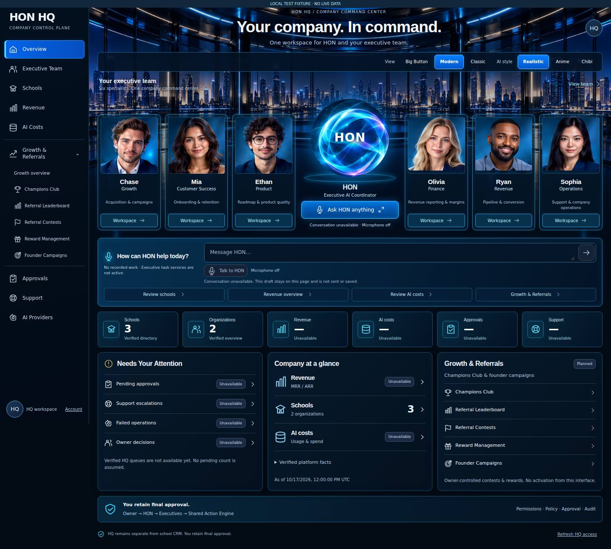
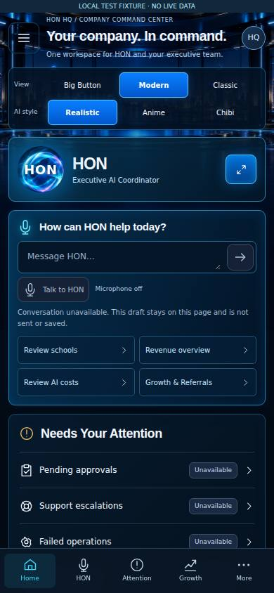

# HQ visual reference refinement

Branch: `codex/hq-modern-implementation`. Review: [PR #8](https://github.com/myhonosai/honos/pull/8). Status: **real screenshots ready; owner visual approval pending**. Verified application source: [`c9fe94f`](https://github.com/myhonosai/honos/commit/c9fe94f78012215db894fd964363d332ba807b84).

## Actual application screenshots

[Desktop full resolution](desktop.jpg) · [Mobile viewport](mobile.jpg) · [Mobile full page](mobile-full.jpg) · [Previous implementation](../hq-modern/README.md)

These are unresized JPEG browser captures of the real production web build. All captures visibly say **LOCAL TEST FIXTURE · NO LIVE DATA**. School/organization counts are synthetic fixtures, not HON company results. The background is decorative generated artwork; the controls, cards, navigation, draft composer and data states are actual rendered application components.

[All 18 original PNG captures and reports](https://github.com/myhonosai/honos/actions/runs/39107056742/artifacts/12128980931) are in a private Actions artifact with three-day retention. Selected repository images remain accessible after that artifact expires. The fixed mobile navigation appears at the initial viewport location in full-page capture; use the mobile viewport image to assess the visible screen.

## Reference and implementation

The owner supplied `9075.jpg` as a closer visual target after reviewing the first running HQ implementation. This iteration adapts its panoramic command-room setting, portrait-led glass cards, central glowing HON and compact performance tiles to **HON HQ**. It does not copy the reference's school navigation, school employee identities, sample metrics, dates, readiness badges or company/customer names.

The six HQ executives and approved portrait/orb sources are retained. New decorative artwork is isolated under `apps/web/public/hq-assets/reference-refinement/`, with its own source/approval notes. Existing approved files and the [previous real screenshots](../hq-modern/README.md) are preserved for comparison.

Desktop places three executives on each side of HON, a real local-draft composer below, six company tiles and compact attention/company/growth panels. Mobile keeps HON and key actions ahead of the operational panels and executive grid. All appearance choices, executive entry points and persistent subpage assistant remain available.

Current main `75f3a81` has been incorporated without changing Claude's Champions Club code or contracts. M1 referral recordkeeping now exists upstream; this **visual-only refinement** does not integrate those new endpoints or activate rewards. Existing explicit pending/unavailable states remain until a separate bounded frontend integration.

## Actual verification

[Browser run 39107056742](https://github.com/myhonosai/honos/actions/runs/39107056742) on **c9fe94f**: **36 checks passed / 0 failed**, **8 axe scans / 0 reported violations**, **18 PNG captures**. [Sanitized report](browser-report.json).

[Existing CI 39107056740](https://github.com/myhonosai/honos/actions/runs/39107056740) on the same source passed **both jobs**: tests, typecheck, full application build, migration-file contract, clean tracked source and disposable-local PostgreSQL security proofs. No migration was introduced by this HQ visual change or applied to a shared database.

- Production web build with real signed-session gate, disposable signed test session and closed localhost fixture API; no production backend or customer data.
- 1440×1000 desktop, 834×1112 tablet, 390×844 mobile and 320×800 narrow mobile; no horizontal overflow in Modern, Big Button or Classic.
- All six HQ identities, Realistic/Chibi artwork and explicit Anime-pending fallback remain consistent.
- Navigation, executive workspace/tabs, assistant expand/minimize, unsent draft continuity, Escape/opener focus and mobile focus containment pass.
- Anonymous sessions redirect to login; 401/403/503 and malformed overview states hide HQ content. No browser errors or fixture API mutation calls.
- Real visual inspection caught mobile panels shrinking to content width; stretch alignment now fills the screen, attention precedes summary tiles and executive portraits use two columns on phones.

Automated accessibility still has incomplete rules requiring human review; it is not a full WCAG certification. Physical-device software-keyboard and screen-reader checks remain pending. External font requests are deliberately blocked, so screenshots use system fallbacks.

Conversation, voice, executive tasks, finance/AI-cost feeds and attention/support operations remain unavailable. Referral recordkeeping from Claude's merged M1 is not yet integrated into this UI; contests and rewards remain planned/disabled.

No merge, deployment, production-security change or live service activation is authorized. The previous implementation and its source artwork remain preserved.
