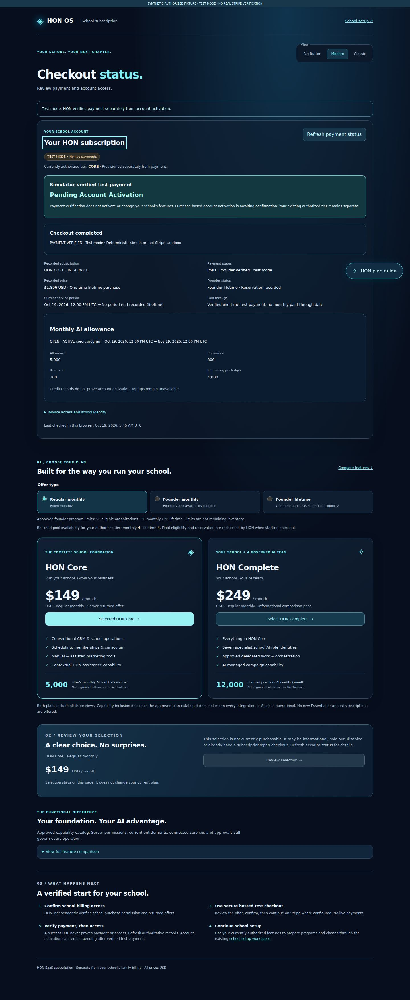
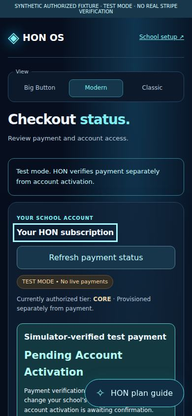

# School TEST_MODE checkout — actual application evidence

[PR #31](https://github.com/myhonosai/honos/pull/31), branch `codex/school-checkout-test-mode`. Capture source `af5a0c135f6b37ac37f53d063758126e619caaa7`, based on merged B5 main `d823edc`.

These are real production Next application screenshots with authenticated, typed **synthetic localhost B5/B3 HTTP fixtures**, not concepts or customer/payment records. No database or Stripe credentials were supplied to the browser harness. A deterministic hosted-page stand-in exercises the external-link/return mechanics without contacting Stripe. **Real Stripe sandbox has not been verified.** Simulator receipts remain visibly distinct from actual Stripe-provider evidence in the UI. The fixture banner is added only by the browser harness; production components have no fixture switch/import.

## Desktop and mobile

| State | Desktop | Mobile |
| --- | --- | --- |
| Authoritative offers versus informational comparison | [Full page](desktop-offers.jpg) | [Full page](mobile-offers.jpg) |
| Explicit offer review and owner confirmation | [Full page](desktop-review.jpg) | [Full page](mobile-review.jpg) |
| Open simulator checkout, payment pending | [Full page](desktop-open.jpg) | [Full page](mobile-open.jpg) |
| Verified test payment, subscription/credits, activation pending | [Full page](desktop-paid.jpg) | [Full page](mobile-paid.jpg) |
| Return status in initial viewport | [Viewport](desktop-paid-viewport.jpg) | [Viewport](mobile-paid-viewport.jpg) |
| Expanded HON guidance | [Viewport](desktop-guide.jpg) | [Viewport](mobile-guide.jpg) |

## Actual results and limits

- [Browser 39206062025](https://github.com/myhonosai/honos/actions/runs/39206062025): **58 checks passed, 12 PNG captures and 20 axe scans**, zero failures, reported violations, JavaScript errors or unexpected API paths. Four viewports: 1440×1000, 834×1112, 390×844 and 320×800. These JPEGs are byte-identical browser captures; full PNGs and sanitized report are in the private run artifact (3-day retention).
- Coverage: all six display prices and all three modes; independently authorized offers/current school; explicit confirmation and duplicate lock; same-key unknown retry; provider unavailable; price/permission changes before POST; signed external handoff/return; backend paid/period/founder/actual allowance; pending/canceled/expired/failed/review/disputed/refunded/past-due/attested; disabled old hosted links; denied/empty/scope/drift/stale data; forged success/cancel URLs; invalid/expired/unsigned sessions; keyboard/HON/overflow and mobile activation visibility.
- [Full CI 39206062051](https://github.com/myhonosai/honos/actions/runs/39206062051) **passed both jobs on the capture source: 641 web / 419 API / 188 domain / 91 auth tests**, typecheck/build, 157 migrations, all 15 disposable proofs / 238 forced-RLS tables. Frontend HTTP tests validate real merged B5/B3 contracts; backend proofs separately exercise Claude's actual services, Stripe adapter/signature handling and PostgreSQL security with its deterministic simulator. Browser fixtures alone are not real backend payment settlement or real sandbox evidence. Exact final-head results are maintained in #31/#4.

One incomplete axe rule per scan requires manual review. Physical iOS/Android keyboards/rotation, VoiceOver/NVDA, zoom and final contrast/readability remain manual QA; no full WCAG claim. External font hosts were blocked, so fallback fonts are captured. The important paid/pending-activation heading is explicitly checked within the initial desktop/mobile viewport.

## Still unavailable

School invoice detail/download (a returned invoice ID is only a reference); ambiguous/multi-school purchaser selection; B6 purchase-to-entitlement activation; real Stripe sandbox approval/credentials/webhook/egress/program verification. An unresolved CREATED checkout after full browser reload may need support because pending retry keys are not persisted. B5 purchases only the existing provisioned tier. Actual test payment or credit records do not prove activated features.

No production deployment, live payments, provider spending/activation, refunds, reward fulfillment, production database work, backend/CRM/migration edits or merge. [Handoff](../../../CODEX_SCHOOL_CHECKOUT.md); backend coordination #29 / Claude #30 / Manus #27.
