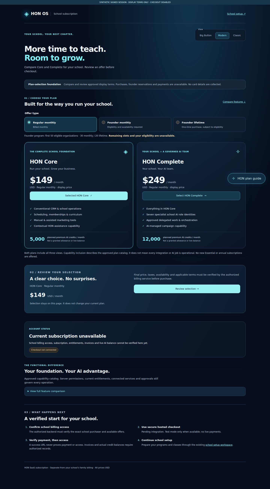
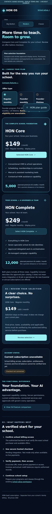

# School subscription — actual application review

PR [#28](https://github.com/myhonosai/honos/pull/28), branch `codex/school-subscription-foundation`. Capture source: `5f12f26a97dfcb12e49cc512cbaaf16e4982bede`.

These are actual production Next application captures, not concept images. Only ephemeral correctly signed synthetic sessions were used. No customer data, database or billing service was used. Prices/credit planning metadata come from the merged approved catalogs, not a simulated subscription. The screenshot fixture label exists only in the browser harness. Checkout remains disabled; current account, inventory/eligibility, invoices and live credit facts remain unavailable. B5 #26 was unmerged at capture time.

## Desktop and mobile

| Plan selection | Review summary |
| --- | --- |
| [Desktop full page](desktop-plans.jpg) | [Desktop review](desktop-review.jpg) |
| [Mobile full page](mobile-plans.jpg) | [Mobile review](mobile-review.jpg) |
| [Desktop initial viewport](desktop-viewport.jpg) | [Mobile initial viewport](mobile-viewport.jpg) |
| [Desktop expanded capabilities](desktop-comparison.jpg) | [Mobile expanded capabilities](mobile-comparison.jpg) |
| [Desktop HON guidance](desktop-guide.jpg) | [Mobile HON guidance](mobile-guide.jpg) |

## Actual verification

- [Browser run 39193167219](https://github.com/myhonosai/honos/actions/runs/39193167219): **37 checks passed, 10 PNG captures, 16 axe scans**, zero failures, reported violations, JavaScript errors, billing API requests or mutations. Durable JPEGs here are byte-identical browser captures. Full PNGs and sanitized report are in that run's private artifact (3-day retention).
- Four viewports: desktop 1440×1000, tablet 834×1112, mobile 390×844 and narrow 320×800. All six prices, three modes, review/acknowledgement reset, commit-timed keyboard focus restoration, keyboard-expandable capability table and HON controls, no horizontal overflow, forged URL non-authority, unsigned/tampered/expired session refusal and no private billing facts/actions for other signed identities.
- [CI run 39193167223](https://github.com/myhonosai/honos/actions/runs/39193167223) verifies the same capture source with the unchanged full repository test/typecheck/build/migration and disposable security pipeline. Exact final-head status is maintained in #28/#4.
- Focused checks: 19 tests (10 new subscription, 7 public catalog, 2 signed-route layout). Unchanged backend authorization/tenant and financial restrictions are regression-tested in the full CI proofs; this foundation does not claim school purchase authorization or payment-provider integration has been tested.

One incomplete axe rule per scan requires manual review. Physical iOS/Android rotation/software keyboard, VoiceOver/NVDA reading order/focus announcements, 200–400% zoom and final contrast/readability remain manual QA; no full WCAG claim. External font hosts were blocked; system fallback fonts are captured.

The first harness run incorrectly probed an intentionally unconfigured login endpoint; it now probes the actual protected route with a correctly signed disposable session. Browser testing found and fixed edit-focus restoration on tablet/narrow screens. Final captures also use a compact mobile offer group, account status below selection and an expandable detailed comparison. No application auth bypass was introduced.

## Still required before purchasing is operational

Approved merged B5 contracts; independently verified purchaser/current-school context; real authorized plan/inventory/eligibility/payment/entitlement/allowance and school-invoice reads; approved Stripe test credentials/webhook/egress and real test-account verification; published billing/tax/cancellation/lifetime terms and backend access policy. A checkout return URL cannot confirm payment or access. No merge, deployment, live payments, provider activation, refunds or reward fulfillment.
